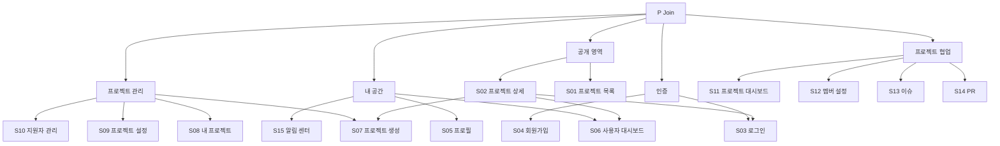

# P Join · 정보 구조 및 화면 명세

[제품 요구사항](01_prd.md)의 기능 ID와 [핵심 유저 플로우](03_userflow.md)의 화면·모달 ID를 함께 참조합니다.

- [페이지별 화면 명세](#screen-specs)
- [모달·오버레이 명세](#modal-specs)
- [공통 UI 모듈](#ui-components)
- [디자인 시스템](#design-system)

## [IA](https://www.figma.com/resource-library/what-is-information-architecture/) · 화면 목록

| ID | 화면명·경로 | 목적·주요 정보 | 주요 동작 | 연결 기능 |
| --- | --- | --- | --- | --- |
| S01 | 프로젝트 목록 `/project` | 공개 프로젝트, 프로젝트명 검색·기술 스택·모집 상태 필터, 최신순 기본값과 열린 정렬 드롭다운 시안, 카드별 모집 상태·D-n | 검색·필터·초기화·무한 스크롤·상세 진입 | F06 |
| S02 | 프로젝트 상세 `/project/{id}` | 프로젝트 설명·기술 스택·모집자 프로필 사진과 닉네임·모집 상태 | 좋아요·북마크·지원하기·지원 취소 | F07~F09 |
| S03 | 로그인 `/login` | ID 또는 이메일/PW 입력, 비활성·활성 버튼, 일반 인증 오류 | 로그인·회원가입 이동 | F01, F03 |
| S04 | 회원가입 `/signup` | ID/PW/이메일/닉네임 필수 입력, 비활성·활성 버튼, 제출 후 인라인 오류 | 계정 생성 시 ID·닉네임 중복 검사·로그인 이동 | F02, F03 |
| S05 | 내 프로필 `/account` | 프로필 정보·계정 보안·GitHub 계정 카드, 사진 업로드, GitHub ID·외부 프로필 링크 | 정보 저장·GitHub 계정 연결·해제·회원 탈퇴 | F04, F05, F17 |
| S06 | 사용자 대시보드 `/dashboard` | 참여·지원 대기·승인·북마크 상태를 2×2 벤토그리드로 표시 | 상태 확인·지원 취소·프로젝트 진입 | F08, F14, F20 |
| S07 | 프로젝트 생성 `/new-project` | 제목·설명·이미지·기술 스택·연결 계정 기준 저장소 선택 | 프로젝트 생성·GitHub 저장소 연결 | F10, F17 |
| S08 | 내 프로젝트 `/admin/project` | 프로젝트 선택 드롭다운과 선택된 프로젝트의 제목·설명·상세·저장소·PR·리뷰 현황 | 프로젝트 선택·설정·지원자 화면 이동·PR 생성·리뷰·병합 승인 | F11~F13, F19 |
| S09 | 프로젝트 설정 `/admin/setting/{id}` | 프로젝트 정보·검색형 기술 스택·모집 기간·연결 계정의 GitHub 저장소·활동 그래프 | 프로젝트 정보 저장·기술 스택 선택·저장소 변경·저장소 연결 해제·지원자 보기 | F09, F12, F17 |
| S10 | 지원자 관리 `/admin/applicants/{id}` | 지원자 프로필·코멘트·상태 | 승인·거절·검색 | F13, F16 |
| S11 | 프로젝트 대시보드 `/project/{id}/dashboard` | 프로젝트 개요·주간 목표·최근 활동·협업·일정, 오른쪽 끝 팀원 카드와 아래 여백 | 일정 등록·수정·삭제, 팀원 정보 확인, 이슈·PR·멤버 관리 진입 | F15, F16, F18, F19 |
| S12 | 프로젝트 멤버 설정 `/project/{id}/settings` | 소유자·멤버·권한 | 강퇴·탈퇴·소유권 이전 | F16 |
| S13 | 프로젝트 이슈 `/project/{id}/issues` | GitHub Issues 목록·상세 | 생성·수정·상태 변경 | F17, F18 |
| S14 | 프로젝트 PR `/project/{id}/pull-requests` | PR 목록·상세·작성자·리뷰 상태·병합 조건 | PR 생성·리뷰·리뷰 완료 후 병합 승인 | F17, F19 |
| S15 | 알림 센터 `/notifications` | 읽음·안 읽음 알림 | 열기·읽음 처리·삭제 | F20 |
| S16 | 공통 오류·권한 안내 | 404·비로그인·권한 없음·외부 연동 오류 | 로그인·이전·재시도 | F01, F07, F15, F17~F20 |

### 공통 모달·오버레이 목록

| ID | 모달명 | 호출 화면·상황 | 주요 내용·동작 | 연결 기능 |
| --- | --- | --- | --- | --- |
| M01 | 회원 탈퇴 확인 | S05 프로필에서 회원 탈퇴 | 탈퇴 영향 안내, 최종 확인·취소 | F04, F21 |
| M02 | 지원 취소 확인 | S06 대시보드 또는 S02 상세에서 지원 취소 | 지원 취소 여부 확인 | F08, F21 |
| M03 | 변경사항 폐기 확인 | S09 프로젝트 정보 수정 중 이탈 | 저장하지 않은 변경사항 폐기·계속 편집 | F12, F21 |
| M04 | 지원 거절 확인 | S10 지원자 관리 | 대상 지원자 또는 전체 대상 인원 표시 후 거절 | F13, F21 |
| M05 | 멤버 강퇴 확인 | S12 멤버 설정 | 강퇴 대상·영향 안내 후 확인 | F16, F21 |
| M06 | 프로젝트 탈퇴 확인 | S11 또는 S12 | 프로젝트 탈퇴 영향 안내 후 확인 | F16, F21 |
| M07 | 소유권 이전 확인 | S12에서 소유자가 이전 대상 선택 | 새 소유자와 권한 변경 내용을 확인 | F16, F21 |
| M08 | GitHub 계정 연결 해제 확인 | S05 | 연결 계정·영향받는 프로젝트 안내 후 사용자 계정 연결 해제 | F17, F21 |
| M09 | PR 병합 확인 | S14 PR 상세 | 대상 PR·병합 결과 영향 확인 | F19, F21 |
| M10 | 이슈 생성·수정 폼 | S13 | 제목·본문·상태 등 간단한 입력 | F18, F21 |
| M11 | PR 생성·리뷰 폼 | S14 | PR 생성 정보 또는 리뷰 내용 입력 | F19, F21 |
| M12 | 지원 신청 | S02 프로젝트 상세 | 지원 코멘트 입력 및 개인정보 수집·이용 동의 후 신청 | F08, F21 |
| M13 | 위클리 일정 등록·수정 | S11 | 날짜·시간·플랫폼·링크 입력 | F15, F21 |
| M14 | 위클리 일정 날짜 선택 | M13 | 달력 모달에서 날짜 선택 | F15, F21 |
| M15 | 위클리 일정 삭제 확인 | S11 | 대상 일정과 삭제 영향 확인 | F15, F21 |
| M16 | 팀원 정보 | S11 | 중앙 모달에서 프로필·연락처·활동 확인 | F16, F21 |
| M17 | GitHub 저장소 연결 해제 확인 | S09 프로젝트 설정 | 프로젝트 연결만 해제하고 GitHub 계정과 동기화 기록은 유지 | F17, F21 |
| M18 | GitHub 저장소 선택 | S07 프로젝트 생성, S09 프로젝트 설정 | 접근 가능한 저장소 검색·단일 선택·연결 상태 확인 | F17 |

> 모달은 별도 페이지가 아니라 현재 화면 위에 표시되는 오버레이입니다. 모달을 닫으면 호출한 화면과 작업 맥락으로 돌아갑니다.
> 

### 화면 지도

아래 구조는 화면의 상위 메뉴와 하위 페이지 관계를 나타냅니다. 상세한 이동 경로는 유저 플로우를 참고하세요.

## 시안·화면 설계 문서

페이지별 구성과 상태, 예외는 [페이지별 화면 명세](#screen-specs)에 정리했습니다. 공통 시각 토큰은 [디자인 시스템](#design-system), 재사용 UI 파츠와 입력 정책은 [공통 UI 모듈](#ui-components), 모달 동작은 [모달·오버레이 명세](#modal-specs)를 기준으로 합니다. 화면별 Figma 프레임 링크는 페이지 정의 문서에 연결되어 있습니다.

### 시안 공통 규칙

- 데스크톱 프레임 너비는 1440px이며 높이는 콘텐츠에 따릅니다. 콘텐츠 폭은 1240px, 좌우 여백은 각각 100px로 페이지와 헤더의 기준선을 맞춥니다.
- 모든 페이지·모달의 글꼴은 Pretendard로 통일합니다. 흰색·검정·회색 중심의 미니멀 스타일을 사용합니다. 강조색은 코발트 블루 `#002CFA`이며 글자·버튼 윤곽선에만 사용합니다. 불투명도 10%(투명도 90%) 파생값 `#002CFA1A`를 토큰으로 정의하되 배경·카드·필드 채움에는 적용하지 않습니다.
- 주요 버튼은 `#1C1C1C`, 전체 라운딩은 16px, 일반 버튼 패딩은 좌우 24px·상하 16px입니다. 기존 예외로 지정된 로그인 버튼, 이메일·비밀번호 필드, 모달 버튼은 크기를 변경하지 않습니다.
- 기술 스택 로고는 공식 색을 유지한 약 25×25px 이미지로 표시합니다. 좋아요 하트와 알림 배지는 의미 색상 예외입니다.
- 모달은 화면 중앙, 배경은 균일하게 딤 처리하며 헤더 프로필·알림도 배경과 함께 어두워져야 합니다.

## 페이지별 Figma 시안 명세

> 각 화면의 구조·상태·입력 정책을 다른 디자인 문서로 옮겨도 그대로 재구성할 수 있도록 목적, 배치, 동작과 예외를 정의합니다. 구현 기술은 다루지 않습니다.
>
> - 비주얼 토큰: [디자인 시스템](#design-system)
> - 재사용 파츠와 인터랙션: [공통 UI 모듈](#ui-components)
> - 모달 상세: [모달·오버레이 명세](#modal-specs)
> - [제품 요구사항](01_prd.md) · [핵심 유저 플로우](03_userflow.md)
> - [P Join Figma 디자인 파일](https://www.figma.com/design/5vNU5XRiZapt6pg2AbvwrZ/P-Join)

### 화면 인덱스

| 화면 | 이름 | 목적 | Figma 프레임 |
| --- | --- | --- | --- |
| S01 | 프로젝트 목록 | 프로젝트를 검색·필터링하고 상세로 이동 | [기본](https://www.figma.com/design/5vNU5XRiZapt6pg2AbvwrZ/P-Join?node-id=2-3) · [정렬 열림](https://www.figma.com/design/5vNU5XRiZapt6pg2AbvwrZ/P-Join?node-id=42-2) · [알림 패널](https://www.figma.com/design/5vNU5XRiZapt6pg2AbvwrZ/P-Join?node-id=69-6) |
| S02 | 프로젝트 상세 | 프로젝트 설명·모집자 확인과 지원 | [기본](https://www.figma.com/design/5vNU5XRiZapt6pg2AbvwrZ/P-Join?node-id=2-30) |
| S03 | 로그인 | ID 또는 이메일로 로그인 | [입력 대기](https://www.figma.com/design/5vNU5XRiZapt6pg2AbvwrZ/P-Join?node-id=2-55) · [입력 완료](https://www.figma.com/design/5vNU5XRiZapt6pg2AbvwrZ/P-Join?node-id=79-122) · [인증 오류](https://www.figma.com/design/5vNU5XRiZapt6pg2AbvwrZ/P-Join?node-id=79-150) |
| S04 | 회원가입 | ID·비밀번호·이메일·닉네임으로 가입 | [입력 대기](https://www.figma.com/design/5vNU5XRiZapt6pg2AbvwrZ/P-Join?node-id=2-78) · [입력 완료](https://www.figma.com/design/5vNU5XRiZapt6pg2AbvwrZ/P-Join?node-id=79-61) · [입력 오류](https://www.figma.com/design/5vNU5XRiZapt6pg2AbvwrZ/P-Join?node-id=79-90) |
| S05 | 내 프로필 | 프로필·사진·외부 계정 관리 | [기본](https://www.figma.com/design/5vNU5XRiZapt6pg2AbvwrZ/P-Join?node-id=2-99) |
| S06 | 사용자 대시보드 | 지원·참여 프로젝트와 북마크 확인 | [기본](https://www.figma.com/design/5vNU5XRiZapt6pg2AbvwrZ/P-Join?node-id=2-133) |
| S07 | 프로젝트 생성 | 새 프로젝트 정보 입력 | [기본](https://www.figma.com/design/5vNU5XRiZapt6pg2AbvwrZ/P-Join?node-id=2-168) |
| S08 | 내 프로젝트 | 선택 프로젝트의 관리 정보 확인 | [기본](https://www.figma.com/design/5vNU5XRiZapt6pg2AbvwrZ/P-Join?node-id=2-190) |
| S09 | 프로젝트 설정 | 프로젝트·기술 스택·저장소·모집 기간 관리 | [기본](https://www.figma.com/design/5vNU5XRiZapt6pg2AbvwrZ/P-Join?node-id=2-218) |
| S10 | 지원자 관리 | 지원자 검토·승인·거절 | [기본](https://www.figma.com/design/5vNU5XRiZapt6pg2AbvwrZ/P-Join?node-id=2-257) |
| S11 | 프로젝트 대시보드 | 프로젝트 내부 협업 요약 | [기본](https://www.figma.com/design/5vNU5XRiZapt6pg2AbvwrZ/P-Join?node-id=2-289) |
| S12 | 프로젝트 멤버 설정 | 멤버 권한·탈퇴·소유권 관리 | [기본](https://www.figma.com/design/5vNU5XRiZapt6pg2AbvwrZ/P-Join?node-id=2-315) |
| S13 | 프로젝트 이슈 | GitHub 이슈 확인·수정 | [기본](https://www.figma.com/design/5vNU5XRiZapt6pg2AbvwrZ/P-Join?node-id=2-361) |
| S14 | 프로젝트 PR | 작성자·리뷰어를 분리한 PR 생성·리뷰 | [기본](https://www.figma.com/design/5vNU5XRiZapt6pg2AbvwrZ/P-Join?node-id=2-392) · [작성자 M11](https://www.figma.com/design/5vNU5XRiZapt6pg2AbvwrZ/P-Join?node-id=6-329) · [리뷰어 M11](https://www.figma.com/design/5vNU5XRiZapt6pg2AbvwrZ/P-Join?node-id=125-2) |
| S15 | 알림 센터 | 알림을 읽고 관련 화면으로 이동 | [populated](https://www.figma.com/design/5vNU5XRiZapt6pg2AbvwrZ/P-Join?node-id=363-10) · [empty](https://www.figma.com/design/5vNU5XRiZapt6pg2AbvwrZ/P-Join?node-id=374-57) · [load error](https://www.figma.com/design/5vNU5XRiZapt6pg2AbvwrZ/P-Join?node-id=374-113) |
| S16 | 공통 오류·권한 안내 | 404·로그인 필요·권한·연동 오류 안내 | [404 오류 안내 프레임](https://www.figma.com/design/5vNU5XRiZapt6pg2AbvwrZ/P-Join?node-id=2-457) · [S16 페이지](https://www.figma.com/design/5vNU5XRiZapt6pg2AbvwrZ/P-Join?node-id=2-456) |

### 공통 화면 규칙

- 데스크톱 프레임 너비는 1440px이며 높이는 콘텐츠에 따릅니다(S01은 1068px, 주요 화면은 940px). 콘텐츠 최대 폭 1240px, 좌우 100px 기준선을 사용합니다. 헤더의 로고·프로필 기준선도 본문과 맞춥니다.
- 공통 헤더는 높이 76px, 하단 구분선 1px이며 `프로젝트 탐색`·`내 프로젝트`·알림·프로필 순서입니다.
- 모든 화면·모달 텍스트는 Pretendard를 사용합니다. 흰색 배경, 검정·회색 텍스트를 기본으로 하며 강조색 `#002CFA`는 글자·버튼 윤곽선에만 사용합니다. 90% 투명 강조색 `#002CFA1A`(불투명도 10%)는 정의된 토큰이며 화면 면 채움에는 적용하지 않습니다. 주요 버튼은 `#1C1C1C`입니다.
- 모든 라운드 요소는 16px입니다. 일반 버튼 패딩은 좌우 24px·상하 16px, 버튼 간격은 24px입니다. 로그인 버튼, 이메일·비밀번호 입력, 모달 버튼은 기존 크기를 유지합니다.
- 프로젝트 카드·폼·모달은 얇은 중립색 윤곽선을 사용합니다. 화면을 불필요한 박스로 나누지 않고, 하나의 목적을 가진 묶음만 카드로 감쌉니다.
- 모달 프레임은 기본 화면을 복제한 상태로 구성하고, 중앙 모달 외부의 로고·사진·알림·콘텐츠 전체에 딤을 적용합니다.

### S01 · 프로젝트 목록

**경로:** `/project` · **목적:** 검색과 조건 탐색을 통해 프로젝트 상세로 이동합니다. · **기능:** F06

#### 페이지 파츠와 배치

| 영역 | 구성 |
| --- | --- |
| 헤더 | 공통 헤더, 원형 알림 버튼과 빨간 숫자 배지, 프로필 사진 |
| 검색·정렬 행 | 프로젝트명 검색, 기술 스택 검색, 정렬 버튼, 프로젝트 등록 버튼 |
| 필터 | 모집 중만 보기 토글, 기술 스택 선택 목록, 필터 초기화 |
| 결과 영역 | 3열 프로젝트 카드 목록, 카드별 메타·제목·설명·기술 로고·모집 상태·D-n·좋아요·북마크 |
| 보조 상태 | 무한 스크롤 로딩, 결과 없음, 불러오기 오류 |

#### 동작·입력 정책

- 프로젝트명과 기술 스택 검색은 입력 즉시 현재 결과에 반영합니다. 적용된 검색·필터 조건은 초기화할 수 있습니다.
- 정렬 기본값은 최신순입니다. 정렬 버튼과 `프로젝트 등록` 버튼은 같은 높이·크기 기준을 사용하고 사이 간격은 24px입니다.
- 최신순·인기순은 드롭다운 선택 항목입니다. Figma에는 닫힘 상태와 열린 상태를 나란히 둡니다. 인기순 집계 기준이 확정되지 않았다면 선택 항목에 설명을 붙이고 결과 기준이 정해진 것처럼 표현하지 않습니다.
- 프로젝트 목록은 스크롤로 이어서 불러옵니다. `더보기` 버튼이나 `프로젝트 목록 24개` 제목을 두지 않습니다.
- 기술 스택 로고는 공식 컬러 원본을 사용하며 약 25×25px로 표시합니다. 이미지는 흑백 처리하지 않습니다.
- 정원 관련 숫자나 입력란을 표시하지 않습니다. 모집 상태와 종료일까지의 D-n은 별개 정보로 보여줍니다.
- 검색 결과가 없으면 현재 조건을 보여주고 조건 수정·초기화 경로를 제공합니다. 불러오기에 실패하면 조건을 보존한 채 재시도할 수 있습니다.

### S02 · 프로젝트 상세

**경로:** `/project/{id}` · **목적:** 모집 내용을 충분히 읽고 모집자와 함께할지 판단합니다. · **기능:** F07–F09

#### 페이지 파츠

- 상단: 공통 헤더, 프로젝트 탐색 경로, 프로젝트 제목·요약·기술 스택
- 본문: 프로젝트 소개, 함께할 역할, 원하는 참여자, 기대 경험, 함께하는 과정 등 세부 섹션
- 보조 영역: 모집자 프로필 사진·닉네임, 소개, `만들며 성장할 수 있도록` 안내
- 하단/사이드 행동: 좋아요, 북마크, `지원하기` 또는 `지원 취소`

#### 동작·예외

- 모집자 사진과 닉네임은 보조 패널에 함께 표시합니다. 프로필 사진은 S05에서 올린 현재 사진과 일치해야 합니다.
- 좋아요는 기본 상태와 선택 상태를 구분하고, 선택 상태 하트는 빨강입니다. 북마크는 Google Material 계열 아이콘을 사용하며 외곽선·채움 상태를 구분합니다.
- 로그인하지 않은 사용자가 지원하기를 선택하면 S03을 거쳐 원래 프로젝트로 돌아옵니다.
- 모집 가능한 프로젝트의 `지원하기`는 M12를 엽니다. 성공 후 버튼은 `지원 취소`로 바뀌며 상태를 보여줍니다. 취소 전 M02를 엽니다.
- 본인 프로젝트, 모집 기간 외 프로젝트, 이미 지원·참여 중인 프로젝트는 신규 지원할 수 없습니다. 이유에 맞는 안내를 표시하고 지원 입력 모달은 열지 않습니다.
- 잘못된 프로젝트 ID는 S16의 404 상태로 안내하고 목록으로 돌아갈 수 있게 합니다.

### S03 · 로그인

**경로:** `/login` · **기능:** F01, F03

#### 페이지 파츠와 상태

- ID 또는 이메일 입력, 비밀번호 입력, 로그인 버튼, 회원가입 이동, 선택형 Google 로그인 진입 (GitHub 로그인은 제공하지 않음)
- 입력 대기: 두 입력값 중 하나라도 비어 있으면 로그인 비활성
- 입력 완료: ID/이메일과 비밀번호가 모두 입력되면 로그인 활성
- 인증 오류: 비밀번호 입력 아래에만 `일치하는 회원 정보를 찾을 수 없어요.` 표시

#### 입력 정책·예외

- 로그인 제목은 `ID 또는 이메일`을 안내하지만 입력 필드의 문구는 `아이디 입력`으로 유지합니다.
- 계정 없음·비밀번호 오류·미인증 계정은 같은 오류로 처리해 계정 존재 여부를 추측할 수 없게 합니다.
- 제출 후에도 ID 입력값은 보존합니다. 비밀번호는 오류 문구에 포함하거나 화면에서 노출하지 않습니다.
- 외부 로그인은 Google만 제공합니다. GitHub는 프로필·저장소 연결에 사용하며 로그인 제공자로 노출하지 않습니다.
- 빈 입력은 비활성 버튼으로 막습니다. 인증 실패 메시지는 ID 아래나 페이지 알림에 중복 표시하지 않습니다.
- 로그인 성공 후 원래 요청 화면으로 돌아갑니다. 세션 만료 또는 접근 실패는 S16의 안내 패턴을 사용합니다.

### S04 · 회원가입

**경로:** `/signup` · **기능:** F02, F03

#### 페이지 파츠와 상태

| 순서 | 필드 | 규칙 |
| --- | --- | --- |
| 1 | ID | 필수, 중복은 계정 만들기 제출 시 검사 |
| 2 | 비밀번호 | 필수, 최소 8자 |
| 3 | 이메일 | 필수, 이메일 형식 검사 |
| 4 | 닉네임 | 필수, 입력값·중복 검사 |

- 입력 대기: 필수 네 필드가 모두 채워지기 전 계정 만들기 버튼 비활성
- 입력 완료: 모든 필수값 입력 후 버튼 활성
- 제출 오류: ID 중복, 닉네임 중복, 비밀번호 길이, 이메일 형식을 각 필드 아래에 표시

#### 입력 정책·예외

- 별도 ID 중복 확인 버튼은 없습니다. 계정 만들기를 눌렀을 때 검사합니다.
- 필드별 인라인 오류를 사용하며 오류가 나도 이미 입력한 비밀번호 외 필드값을 유지합니다.
- 비밀번호 특수문자 정책과 이메일 인증 필요 여부는 PRD에서 확정되지 않았습니다. 추가 제약을 임의로 표시하지 않습니다.
- 전송 중 중복 클릭은 막고, 실패 시 입력값을 유지해 수정·재시도할 수 있게 합니다.

### S05 · 내 프로필

**경로:** `/account` · **기능:** F04, F05, F17

**Figma 상태:** [기본·GitHub 미연결](https://www.figma.com/design/5vNU5XRiZapt6pg2AbvwrZ/P-Join?node-id=2-99) · [GitHub 연결 완료](https://www.figma.com/design/5vNU5XRiZapt6pg2AbvwrZ/P-Join?node-id=377-2) · [회원 탈퇴 확인](https://www.figma.com/design/5vNU5XRiZapt6pg2AbvwrZ/P-Join?node-id=6-3)

> Figma 기본 프레임은 프로필 사진 업로드와 GitHub 미연결 상태를 포함합니다. 연결 완료 예시는 별도 프레임에서 계정 ID와 프로필 링크, 연결 해제 동작을 보여줍니다.

#### 페이지 파츠

- 벤토그리드 2열: `프로필 정보` 카드(사진 미리보기·사진 업로드·닉네임·소개글), `계정 보안` 카드(외부 URL·비밀번호 변경), 하단 전체 폭 `GitHub 계정` 카드
- 페이지 제목 오른쪽의 프로필 저장 버튼과 저장 결과 피드백
- 프로필 사진 미리보기·업로드·교체와 GitHub 계정 연결 상태
- 연결 완료 상태: GitHub 아바타, `GitHub ID`와 예시 `@minji-dev`, `GitHub 프로필 보기 ↗` 외부 링크, `연결 해제` 동작
- 미연결 상태: `연결된 계정 없음` 안내와 `GitHub 계정 연결` 버튼
- 회원 탈퇴 진입과 M01 확인 모달

#### 입력 정책·예외

- 프로필 사진은 JPG/JPEG 또는 PNG, 최대 5MB입니다. 미리보기 후 저장하며, 파일이 잘못되면 기존 사진을 보존하고 입력 근처에 오류를 표시합니다.
- 닉네임은 필수 여부와 길이 제한이 PRD에 명시되지 않았으므로 현재 시안에서 요구하지 않는 제약을 추가하지 않습니다. 중복 및 허용 문자 규칙은 저장 전에 검사해 인라인으로 안내합니다.
- 외부 URL 형식 오류는 URL 필드 아래에 표시합니다. 소개글 길이 제한은 별도 정책 결정 전까지 임의로 고정하지 않습니다.
- GitHub 계정 연결은 로그인 제공자 선택이 아니며, 현재 P Join 로그인 세션을 유지한 채 연결합니다. GitHub ID는 공개 로그인 이름(`@minji-dev`)으로 표시하고 내부 식별자 숫자는 화면에 노출하지 않습니다.
- `GitHub 프로필 보기 ↗`는 현재 연결된 계정의 `profileUrl`로 이동하며 새 탭에서 엽니다. 계정 미연결·URL 누락 상태에서는 링크를 숨기고 연결 버튼을 표시합니다.
- GitHub 계정 연결 해제는 M08, 특정 프로젝트의 저장소 연결 해제는 S09의 M17을 사용합니다. 계정 연결 해제 시 영향받는 프로젝트를 알리고, 확인 전까지 계정·저장소 상태를 변경하지 않습니다.
- 계정 OAuth가 취소되거나 실패하면 현재 프로필과 연결 상태를 그대로 유지합니다. GitHub 계정이 이미 다른 P Join 사용자에 연결되어 있으면 새 연결·자동 계정 병합을 거절하고 안전한 오류를 안내합니다.
- 소유 프로젝트의 소유권 이전 또는 참여 프로젝트 탈퇴가 완료되지 않은 사용자는 탈퇴할 수 없습니다. 선행 조치와 경로를 먼저 안내합니다.

### S06 · 사용자 대시보드

**경로:** `/dashboard` · **기능:** F08, F14, F20

**Figma 상태:** [기본 벤토그리드](https://www.figma.com/design/5vNU5XRiZapt6pg2AbvwrZ/P-Join?node-id=2-133) · [지원 취소 모달](https://www.figma.com/design/5vNU5XRiZapt6pg2AbvwrZ/P-Join?node-id=6-37)

#### 페이지 파츠

- 프로젝트 상태를 2열 벤토그리드로 표시: 참여 중, 지원 대기, 승인된 프로젝트, 북마크
- 지원 상태: 대기, 승인, 거절, 취소
- 카드별 프로젝트 진입, 상태 확인, 승인 전 지원 취소

#### 동작·예외

- 비로그인 사용자는 로그인 안내 뒤 원래 목적지로 돌아옵니다.
- 대기 상태 지원만 취소할 수 있습니다. M02에서 확인한 뒤 목록의 상태를 갱신합니다.
- 승인 또는 이미 취소된 지원에는 지원 취소 동작을 표시하지 않습니다.
- 목록이 비어 있으면 프로젝트 탐색으로 이어지는 빈 상태를 표시합니다.
- 프로젝트 상태 카드가 한 개 또는 세 개만 있어도 남는 그리드 공간은 비워 두며, 빈 카드를 추가하지 않습니다.

### S07 · 프로젝트 생성

**경로:** `/new-project` · **기능:** F10, F17

#### 페이지 파츠·입력

- 프로젝트 제목, 상세 설명, 대표 이미지, 필요 기술 스택, GitHub 저장소 연결·선택, 생성 버튼
- 필수값 누락·형식 오류는 해당 필드 아래에 표시합니다. 생성 버튼은 필수 항목을 충족해야 활성화합니다.
- 기술 스택은 C05 검색·선택 모듈을 사용합니다. 저장소 연결 버튼을 누르면 GitHub 권한 준비 상태를 확인합니다. 준비된 경우 M18 저장소 선택 모달을 열고, 준비되지 않은 경우 목적과 권한을 안내한 뒤 GitHub 외부 권한 페이지로 이동합니다. GitHub 계정 연결은 SSO 로그인이 아닙니다.
- 외부 GitHub 권한 승인은 팝업이나 P Join 모달에 넣지 않습니다. 전체 페이지 이동 후 callback으로 S07에 돌아오며 프로젝트 입력값을 복원합니다. 승인 취소·실패 시 폼을 유지하고 저장소는 선택하지 않은 상태로 둡니다.
- M18은 연결된 GitHub 계정이 접근 가능한 저장소를 검색하고 프로젝트당 하나만 선택하는 P Join 내부 모달입니다. 선택만으로 프로젝트 저장을 확정하지 않으며, 프로젝트 생성 성공 후 저장소 연결과 동기화를 시작합니다.
- 조직 승인이 필요하거나 접근 가능한 저장소가 없으면 M18 안에서 상황과 다음 행동을 안내합니다. 사용자가 GitHub에서 권한을 변경하면 S07 폼을 유지한 채 다시 조회할 수 있습니다.
- 생성 실패 시 입력과 선택한 로고를 유지합니다. 성공 시 S08 또는 새 프로젝트 대시보드로 이동합니다.
- 대표 이미지 파일 정책은 Figma PRD에서 구체화되지 않았으므로 프로필 이미지 제한을 자동 적용하지 않습니다.

### S08 · 내 프로젝트

**경로:** `/admin/project` · **기능:** F11, F12, F13, F19

#### 시안 설명

여러 프로젝트를 한꺼번에 벤토 그리드 카드로 나열하지 않습니다. 다른 프로젝트 목록은 상단 선택 드롭다운 안에서만 보여주며, 하나를 고르면 단일 프로젝트 상세가 넓은 본문과 우측 요약 패널에 표시됩니다. 선택 즉시 제목·설명·상세·GitHub·PR·리뷰 정보를 선택한 프로젝트 기준으로 함께 교체합니다. 기본 선택 상태의 기준 프레임은 [S08 기본](https://www.figma.com/design/5vNU5XRiZapt6pg2AbvwrZ/P-Join?node-id=2-190)입니다. 프레임은 1440×940px이며 본문 여백 100px, 좌우 열은 814px·402px, 열 간격은 24px입니다. 선택 필드는 x=100, y=244, 400×48px입니다. 개요 카드는 x=100, y=316, 814×180px, 상세 카드는 x=100, y=520, 814×270px입니다. GitHub 카드는 x=938, y=316, 402×180px, PR 카드는 x=938, y=520, 402×210px, 리뷰 조건 카드는 x=938, y=754, 402×112px입니다.

#### 페이지 파츠

| 영역 | 표시 내용 |
| --- | --- |
| 상단 선택부 | `프로젝트 선택` 레이블, 현재 프로젝트 이름, 드롭다운 표시 |
| 프로젝트 개요 | 프로젝트 제목, 기술 스택·생성일, 짧은 설명, 설정·지원자 이동 |
| 상세 소개 | 상세 제목과 충분한 폭의 상세 설명 |
| GitHub | 연동 상태와 저장소 이름 |
| PR 작업 | 열린 PR 요약, PR 생성·리뷰·병합 승인 세 버튼, 담당 역할 라벨 |
| 리뷰 조건 | 리뷰 완료 전 병합 승인이 비활성인 이유와 조건 |

#### 상태·정책

| 상태 | 화면 표현 |
| --- | --- |
| 리뷰 전 | PR 생성·리뷰 활성, 병합 승인 비활성. 현재 Figma 프레임 상태입니다. |
| 리뷰 완료·필수 조건 충족 | 병합 승인 활성. 현재 캔버스에 별도 상태 프레임은 없으며 C08 규칙으로 명세합니다. |
| 변경 요청 미해결 | 병합 승인 비활성 유지 |
| 병합 완료 | 병합 상태 표시, 병합 행동 비활성 |

- 선택한 프로젝트 하나의 제목, 설명, 상세 제목, 상세 설명, GitHub 연동, PR 현황, 코드 리뷰 현황을 함께 교체합니다.
- `PR 생성`은 작성자, `리뷰`는 리뷰어, `병합 승인`은 승인자 단계입니다. 작성자와 리뷰어는 달라야 하며 작성자는 자신의 PR을 리뷰할 수 없습니다.
- 리뷰가 없거나 검토 조건이 완료되지 않은 동안 `병합 승인`은 비활성입니다. 리뷰 완료 후에만 활성화하고, 변경 요청이 남아 있으면 다시 비활성 상태를 유지합니다. 최종 승인 선택은 M09 확인 절차를 거칩니다.
- 프로젝트를 소유하지 않은 사용자는 이 화면에 접근할 수 없습니다. 권한이 없으면 S16 안내를 표시합니다.
- 프로젝트가 없으면 선택 드롭다운 대신 빈 상태와 S07 프로젝트 만들기 동작을 표시합니다.

### S09 · 프로젝트 설정

**경로:** `/admin/setting/{id}` · **기능:** F09, F12, F17

#### 시안 설명

왼쪽 넓은 프로젝트 정보 카드와 오른쪽 두 카드로 구성합니다. 왼쪽에는 프로젝트 제목, 상세 설명, 대표 이미지, 검색형 기술 스택 입력, 자동완성, 저장 버튼이 있습니다. 오른쪽 위에는 모집 기간과 지원자 이동 버튼, 오른쪽 아래에는 저장소 변경·연결 상태·최근 커밋 및 활동 그래프를 둡니다. 모집 상태 선택 패널은 이 화면에서 제거했습니다. 프레임은 1440×940px이며 콘텐츠 좌우 여백은 100px입니다. 왼쪽 열은 x=100, y=220, 814×620px, 오른쪽 열은 x=938, 폭 402px이고 열 간격은 24px입니다. 모집 기간 카드는 y=220, 높이 216px, GitHub 카드는 y=460, 높이 380px이며 오른쪽 카드 사이 간격은 24px입니다.

#### 입력·정책

- 제목·상세 설명·기술 스택 변경을 저장할 수 있습니다. 필수 항목 누락은 해당 필드 아래 인라인 오류로 표시합니다.
- 기술 스택 입력에 `R`을 넣으면 `React`, `Rust` 후보가 입력 바로 아래에 나타납니다. 후보를 선택하면 칩으로 추가하고 중복 선택은 막습니다.
- 모집 기간은 시작일·마감일 두 필드로 설정합니다. 두 필드를 모두 비우면 기간 미설정으로 저장하며 신규 지원을 받지 않습니다. 한 필드만 입력하면 오류를 표시하고, 두 날짜를 설정할 때 시작일이 마감일보다 늦으면 저장을 막습니다. 과거 날짜도 기존 기간 정정을 위해 선택할 수 있습니다.
- `지원자 보러가기`는 현재 선택한 프로젝트의 S10으로 이동합니다.
- `저장소 변경`은 연결된 GitHub 계정이 접근할 수 있는 저장소 선택 흐름으로 이동합니다. 저장소 이름은 버튼 왼쪽에 두고 연결 상태는 그 아래에 표시합니다.
- GitHub 계정 카드에는 연결된 계정의 `@login`과 프로필 링크를 보여줍니다. 저장소를 바꿔도 GitHub 계정 링크는 유지합니다. 이 프로젝트의 저장소 연결만 끊을 때는 M17을 사용합니다.
- 커밋·활동 그래프는 중립 회색 막대를 사용합니다. 활동 없음·조회 오류는 그래프 카드 안의 빈 상태로 표현합니다.
- 저장하지 않은 변경사항이 있는 채 이탈하면 M03을 표시합니다. 계속 편집은 입력을 보존하고, 폐기는 수정 내용을 버립니다.
- PRD의 모집 상태 관리 기능은 현재 화면 시안과 충돌합니다. 시안은 수동 상태 선택을 제거했으며, 상태가 필요한 공개 화면의 표시와 기간 기반 지원 가능 여부는 [제품 요구사항](01_prd.md)의 결정 항목을 따릅니다.

### S10 · 지원자 관리

**경로:** `/admin/applicants/{id}` · **기능:** F13, F16

- 지원자 목록에서 각 지원자의 프로필·닉네임·지원 코멘트·지원 상태를 확인합니다.
- 닉네임 등 검색 조건을 입력하고, 결과 목록에서 개별 지원자를 선택합니다.
- 승인 가능한 지원에는 승인 동작, 거절 가능한 지원에는 거절 동작을 표시합니다. 이미 처리된 지원은 중복 조작을 막습니다.
- 개별 거절은 M04에 대상을 명시합니다. 전체 거절은 대상 범위와 대상 인원수를 분명히 표시합니다.
- 검색 결과가 없으면 검색 조건을 보존한 빈 상태를 표시합니다. 권한이 없는 사용자는 관리 행동을 보지 못하고 S16 안내를 받습니다.

### S11 · 프로젝트 대시보드

**경로:** `/project/{id}/dashboard` · **기능:** F15, F16, F18, F19

**Figma 상태:** [기본](https://www.figma.com/design/5vNU5XRiZapt6pg2AbvwrZ/P-Join?node-id=2-289) · [팀원 정보](https://www.figma.com/design/5vNU5XRiZapt6pg2AbvwrZ/P-Join?node-id=130-2) · [일정 등록](https://www.figma.com/design/5vNU5XRiZapt6pg2AbvwrZ/P-Join?node-id=130-70) · [일정 수정](https://www.figma.com/design/5vNU5XRiZapt6pg2AbvwrZ/P-Join?node-id=130-149) · [일정 삭제 확인](https://www.figma.com/design/5vNU5XRiZapt6pg2AbvwrZ/P-Join?node-id=130-224) · [날짜 달력](https://www.figma.com/design/5vNU5XRiZapt6pg2AbvwrZ/P-Join?node-id=140-4) · [시간 30분 옵션](https://www.figma.com/design/5vNU5XRiZapt6pg2AbvwrZ/P-Join?node-id=140-133) · [플랫폼 드롭다운](https://www.figma.com/design/5vNU5XRiZapt6pg2AbvwrZ/P-Join?node-id=140-219)

- 프로젝트 개요를 상단 전체 폭으로 두고, 주간 목표·최근 활동·협업 도구·다음 위클리 일정을 벤토형 카드로 요약합니다. 멤버 카드는 오른쪽 끝 열에 배치하고 그 아래는 빈 여백으로 남깁니다. S08 프로젝트 선택 화면과 목적을 섞지 않습니다.
- 위클리 일정 카드는 날짜·시간·플랫폼·링크와 일정 추가·수정·삭제 동작을 보여줍니다. 일정 추가·수정 모달은 `520×560px`로 화면 중앙에 두고, 날짜 선택과 시간·플랫폼 옵션은 각각 독립된 열린 상태 프레임으로 제시합니다.
- **예시 데이터 정합성:** 기본 화면, 팀원 패널, 등록·수정·삭제 모달, 달력·시간·플랫폼 상태의 일정 요약은 `2026. 11. 26. (목) · 19:00`으로 맞췄습니다. 날짜 입력 값도 모든 상태에서 `2026. 11. 26. (목)`입니다. 다만 등록 모달과 달력·시간·플랫폼 상태의 일 필드에는 `13일`이 남아 있어 `26일`로 교체해야 합니다. Figma 편집기 Find & Replace에서는 해당 페이지에 결과가 표시되지 않아, 잔여 필드를 직접 선택해 수정할 필요가 있습니다.
- 날짜 필드는 연·월·일을 직접 나누어 입력하지 않고 달력 모달 M14를 호출합니다. 월 이동으로 연·월을 고르고 유효한 날짜를 선택합니다.
- 시간은 24시간제 `HH:mm` 직접 입력 또는 30분 단위 드롭다운으로 선택합니다. 드롭다운은 길어질 수 있어 내부 목록을 스크롤할 수 있습니다. 플랫폼 목록은 S01 정렬 드롭다운의 윤곽선·여백·선택 행 스타일을 재사용하고 필드 폭에 맞춥니다.
- 팀원 이름을 선택하면 가운데 정렬된 `520×500px` 정보 모달을 열어 프로필·역할·연락처·최근 활동·참여 정보를 확인합니다.
- 프로젝트 멤버만 접근할 수 있습니다. 비멤버·만료된 초대는 S16의 권한 안내를 표시합니다.
- 이슈·PR·멤버 설정 진입은 각각 S13·S14·S12로 이동합니다.
- 정보가 없는 카드는 의미 없는 빈 박스로 남기지 않고 안내 문구와 적절한 시작 동작을 표시합니다.
- 날짜 미선택·존재하지 않는 날짜·형식이 잘못된 시간은 제출할 수 없고 해당 입력 근처에 오류를 표시합니다. 드롭다운을 닫거나 모달을 취소해도 입력 중인 값은 유지하며, 삭제 확인을 취소하면 일정을 변경하지 않습니다.

### S12 · 프로젝트 멤버 설정

**경로:** `/project/{id}/settings` · **기능:** F16

- 프로젝트 소유자와 일반 멤버를 구분해 목록에 표시합니다. 이름·프로필 사진·역할을 함께 확인합니다.
- 소유자는 멤버 승인, 강퇴, 권한 관리, 소유권 이전을 수행할 수 있습니다. 일반 멤버는 프로젝트 탈퇴를 선택합니다.
- 강퇴·탈퇴·소유권 이전은 각각 M05·M06·M07 확인을 거칩니다. 모달이 열리기 전에 대상 사용자를 확정하고, 취소하면 목록과 권한을 바꾸지 않습니다.
- 소유권 이전은 기존 멤버만 대상으로 선택할 수 있습니다. 대상이 사라지거나 권한이 바뀐 경우 확인을 막고 현재 목록을 갱신합니다.
- 비멤버에게 관리 행동을 노출하지 않습니다.

### S13 · 프로젝트 이슈

**경로:** `/project/{id}/issues` · **기능:** F17, F18

- 연결된 저장소의 이슈 목록, 상태, 작성자, 제목, 갱신 정보를 표시하고 이슈 선택 시 상세 내용을 확인합니다.
- 생성·수정은 M10 입력 모달을 사용합니다. 상태 변경은 선택한 이슈와 변경 후 상태를 분명히 확인시킨 다음 처리합니다.
- 저장소 연결이 없으면 연결 필요 안내, 권한 부족이면 접근 복구 안내, 외부 서비스 호출 한도에 걸리면 잠시 후 다시 시도할 수 있는 안내를 보여줍니다.
- 이슈가 없으면 S11 대시보드로 돌아가거나 새 이슈를 만들 수 있는 빈 상태를 표시합니다.

### S14 · 프로젝트 PR

**경로:** `/project/{id}/pull-requests` · **기능:** F17, F19

- PR 목록에는 제목·작성자·리뷰 요청 대상·상태를 표시합니다. 다른 작성자의 PR에는 `리뷰하기`를 제공하고, 본인 PR에는 리뷰 액션 대신 `내 PR`과 진행 상태를 표시합니다.
- 작성자 A는 `새 PR 만들기`에서 제목·기준 브랜치·변경 브랜치와 리뷰어 B를 지정해 PR을 생성합니다. 설명은 선택 입력입니다. 버튼은 `PR 생성 및 리뷰 요청`이며, 성공 시 B에게 알림을 보냅니다.
- 리뷰어 B는 요청된 PR의 변경 내용과 대화를 확인하고, 별도 리뷰 화면에서 `승인` 또는 `변경 요청`을 선택해 코멘트와 함께 제출합니다. 작성자와 리뷰어는 반드시 달라야 합니다.
- 변경 요청 후 A가 같은 PR을 갱신하면 B에게 재검토를 요청합니다. 저장소의 필수 승인 조건이 충족되기 전까지 병합은 비활성입니다. 조건 충족 후 권한 있는 사용자가 M09 확인 모달을 거쳐 병합합니다.
- Figma 프레임: [S14 목록](https://www.figma.com/design/5vNU5XRiZapt6pg2AbvwrZ/P-Join?node-id=2-392), [M11 작성자 생성 상태](https://www.figma.com/design/5vNU5XRiZapt6pg2AbvwrZ/P-Join?node-id=6-329), [M11 리뷰어 등록 상태](https://www.figma.com/design/5vNU5XRiZapt6pg2AbvwrZ/P-Join?node-id=125-2).
- 권한 부족·저장소 연결 해제·외부 서비스 오류·호출 한도 상태는 S14에서 안내하고, 입력과 현재 PR 선택은 재시도할 수 있게 보존합니다.

### S15 · 알림 센터

**경로:** `/notifications` · **기능:** F20

- 지원 접수·승인·거절·취소 및 프로젝트 이벤트를 시간순으로 읽습니다. 읽지 않은 항목은 배경색이 아닌 중립 표시점·굵기 등으로 구분합니다.
- 알림을 선택하면 읽음 처리 후 관련 프로젝트나 지원 화면으로 이동합니다.
- 읽은 알림만 삭제할 수 있습니다. 확인 모달 없이 삭제하고 토스트로 결과를 알립니다.
- 보관 기간은 30일이며 기간이 지난 항목은 목록에서 제거됩니다. 만료 안내는 과도한 경고색 대신 보조 문구로 표시합니다.
- 목록이 비면 새 알림이 없음을 안내하고, 불러오기 실패 시 재시도를 제공합니다.

### S16 · 공통 오류·권한 안내

- **현재 Figma 예시:** [404 · 페이지를 찾을 수 없습니다](https://www.figma.com/design/5vNU5XRiZapt6pg2AbvwrZ/P-Join?node-id=2-457). 로그인 필요(401), 접근 권한 없음(403), GitHub 저장소 권한 오류는 화면 명세에 포함되어 있으나 Figma 상태 프레임은 아직 추가되지 않았습니다.
- 404, 로그인 필요, 권한 없음, GitHub 연결 끊김·권한 부족·호출 한도 등 상황별 제목·설명·다음 행동을 표시합니다.
- 복구 동작은 가능한 경우에만 노출합니다. 예: 로그인, 이전 화면, 저장소 재연결, 다시 시도.
- 동일 오류를 토스트·인라인·전체 페이지에 중복 노출하지 않습니다. 현재 작업을 계속할 수 있는 오류는 해당 필드나 카드에, 페이지 접근 자체가 불가능한 오류는 전용 상태 화면에 표시합니다.

## 모달·오버레이 명세

> 모든 모달은 호출한 화면 위에 중앙 정렬합니다. 모달 외부의 헤더·프로필 사진·알림 배지·페이지 콘텐츠 전체는 같은 딤 오버레이 아래에 두고, 모달 패널과 내부 요소만 밝게 유지합니다. 취소는 호출 화면으로 돌아가며 확인·제출 전에는 작업을 확정하지 않습니다.
>
> 공통 시각 기준은 [디자인 시스템](#design-system), 화면 상태는 [페이지별 화면 명세](#screen-specs), 모듈 동작은 [공통 UI 모듈](#ui-components)에 정의합니다.

### 공통 모달 규칙

| 항목 | 규칙 |
| --- | --- |
| 위치 | 호출 화면 프레임의 가로·세로 정중앙 |
| 배경 딤 | 페이지 전체에 중립색 반투명 오버레이 적용. Figma 기준 `#1C1F29`, 불투명도 38% |
| 라운딩 | 16px |
| 계층 | 헤더 로고·프로필·알림·배지·페이지 이미지·본문은 딤 아래, 모달 패널과 내부 요소는 딤 위 |
| 제목 | 수행할 행동과 대상을 구체적으로 표현 |
| 본문 | 영향·되돌릴 수 있는지·필요한 다음 행동을 설명 |
| 버튼 | 취소와 확인을 구분하고 확인 버튼에는 구체 행동명을 사용. 공통 모달 버튼의 기존 크기는 유지 |
| 닫기 | 닫기·취소는 데이터 변경 없이 호출 화면으로 복귀 |
| 처리 중 | 반복 제출을 막고 진행 중임을 알림 |
| 실패 | 입력과 선택을 보존하고 모달 안에 오류와 재시도 방법 표시 |
| 성공 | 요청한 화면 상태를 갱신한 뒤 모달을 닫거나, 후속 선택이 필요하면 열린 상태를 유지 |
| 사용하지 않을 때 | 단순 성공·읽음 처리·읽은 알림 삭제 등 되돌리기 쉽고 결과 안내만 필요한 동작에는 확인 모달을 띄우지 않음 |

### 모달 인덱스

| ID | 모달 | 호출 화면 | 입력 | Figma 상태 |
| --- | --- | --- | --- | --- |
| M01 | 회원 탈퇴 확인 | S05 | 없음 | [S05 모달](https://www.figma.com/design/5vNU5XRiZapt6pg2AbvwrZ/P-Join?node-id=6-3) |
| M02 | 지원 취소 확인 | S02 또는 S06 | 없음 | [S02 모달](https://www.figma.com/design/5vNU5XRiZapt6pg2AbvwrZ/P-Join?node-id=25-117) |
| M03 | 변경사항 폐기 확인 | S09 | 없음 | [S09 모달](https://www.figma.com/design/5vNU5XRiZapt6pg2AbvwrZ/P-Join?node-id=6-72) |
| M04 | 지원 거절 확인 | S10 | 없음 | [S10 모달](https://www.figma.com/design/5vNU5XRiZapt6pg2AbvwrZ/P-Join?node-id=6-136) |
| M05 | 멤버 강퇴 확인 | S12 | 없음 | [S12 모달](https://www.figma.com/design/5vNU5XRiZapt6pg2AbvwrZ/P-Join?node-id=6-168) |
| M06 | 프로젝트 탈퇴 확인 | S11 또는 S12 | 없음 | [S12 모달](https://www.figma.com/design/5vNU5XRiZapt6pg2AbvwrZ/P-Join?node-id=6-200) |
| M07 | 소유권 이전 확인 | S12 | 기존 멤버 선택은 호출 화면에서 완료 | [S12 모달](https://www.figma.com/design/5vNU5XRiZapt6pg2AbvwrZ/P-Join?node-id=6-232) |
| M08 | GitHub 계정 연결 해제 확인 | S05 | 없음 | Figma 상태 추가 필요 |
| M09 | PR 병합 확인 | S14 | 없음 | [S14 모달](https://www.figma.com/design/5vNU5XRiZapt6pg2AbvwrZ/P-Join?node-id=6-295) |
| M10 | 이슈 생성·수정 | S13 | 제목·본문·상태 등 | [S13 모달](https://www.figma.com/design/5vNU5XRiZapt6pg2AbvwrZ/P-Join?node-id=6-264) |
| M11 | PR 생성·리뷰 | S14 | 모드별 입력 | [S14 모달](https://www.figma.com/design/5vNU5XRiZapt6pg2AbvwrZ/P-Join?node-id=6-329) |
| M12 | 지원 신청 | S02 | 코멘트·개인정보 동의 | [S02 모달](https://www.figma.com/design/5vNU5XRiZapt6pg2AbvwrZ/P-Join?node-id=25-53) |
| M13 | 위클리 일정 등록·수정 | S11 | 날짜·시간·플랫폼·링크 입력 | [등록](https://www.figma.com/design/5vNU5XRiZapt6pg2AbvwrZ/P-Join?node-id=130-70) · [수정](https://www.figma.com/design/5vNU5XRiZapt6pg2AbvwrZ/P-Join?node-id=130-149) |
| M14 | 위클리 일정 날짜 선택 | M13 날짜 필드 | 달력에서 날짜 선택 | [달력 모달](https://www.figma.com/design/5vNU5XRiZ/P-Join?node-id=140-4) |
| M15 | 위클리 일정 삭제 확인 | S11 | 선택 일정·삭제 영향 확인 | [삭제 확인](https://www.figma.com/design/5vNU5XRiZ/P-Join?node-id=130-224) |
| M16 | 팀원 정보 | S11 팀원 카드 | 프로필·연락처·활동 정보 | [팀원 패널](https://www.figma.com/design/5vNU5XRiZ/P-Join?node-id=130-2) |
| M17 | GitHub 저장소 연결 해제 확인 | S09 | 현재 프로젝트의 저장소 연결만 해제 | Figma 상태 추가 필요 |
| M18 | GitHub 저장소 선택 | S07 또는 S09 | 저장소 검색, 프로젝트당 한 저장소 선택 | Figma 상태 추가 필요 |

### M01 · 회원 탈퇴 확인

| 항목 | 명세 |
| --- | --- |
| 페이지 명 | 내 프로필 · S05 · `/account` |
| 페이지 파츠 | 탈퇴 영향, 최종 탈퇴, 취소 |
| 모달 명 | 회원 탈퇴 확인 |
| 모달 내용 | 계정 탈퇴 시 세션이 종료되고 계정으로 다시 이용할 수 없음을 알립니다. 소유권 이전이나 참여 프로젝트 탈퇴가 남아 있으면 먼저 처리해야 할 항목과 이동 경로를 제시합니다. |
| 모달 입력 정책 | 입력 없음. 선행 조건이 충족된 경우에만 최종 탈퇴를 실행할 수 있습니다. 취소는 아무 상태도 바꾸지 않습니다. |
| 예외 처리 | 선행 조건이 바뀌었거나 탈퇴 처리에 실패하면 계정을 탈퇴시키지 않고 원인과 해결 경로를 안내합니다. |
| 다음 유저 플로우 | UF09 — 취소 후 S05 복귀, 확인 후 세션 종료 |

### M02 · 지원 취소 확인

| 항목 | 명세 |
| --- | --- |
| 페이지 명 | 프로젝트 상세 · S02 또는 사용자 대시보드 · S06 |
| 페이지 파츠 | 프로젝트명, 취소 영향, 지원 취소, 취소 |
| 모달 명 | 지원 취소 확인 |
| 모달 내용 | 취소할 프로젝트와 지원 상태를 다시 보여주고 지원을 취소할지 확인합니다. |
| 모달 입력 정책 | 입력 없음. 승인 전 상태의 지원에만 표시합니다. 취소 버튼은 호출 화면으로 돌아가며 지원 상태를 유지합니다. |
| 예외 처리 | 이미 승인·거절·취소된 신청이거나 프로젝트 상태가 달라졌으면 취소를 확정하지 않고 최신 상태를 화면에 반영합니다. |
| 다음 유저 플로우 | UF09 — 확인 후 지원 상태를 취소로 바꾸고 S02 또는 S06으로 복귀 |

### M03 · 변경사항 폐기 확인

| 항목 | 명세 |
| --- | --- |
| 페이지 명 | 프로젝트 설정 · S09 · `/admin/setting/{id}` |
| 페이지 파츠 | 저장되지 않은 변경 안내, 변경사항 폐기, 계속 편집 |
| 모달 명 | 변경사항 폐기 확인 |
| 모달 내용 | 저장하지 않은 프로젝트 정보·기술 스택·모집 기간·저장소 변경을 버리고 나갈지 안내합니다. |
| 모달 입력 정책 | 입력 없음. 계속 편집은 현재 편집값을 유지합니다. 폐기는 저장하지 않은 변경만 버립니다. |
| 예외 처리 | 변경사항이 저장되었거나 더 이상 dirty 상태가 아니면 모달을 닫고 해당 변경을 폐기하지 않습니다. |
| 다음 유저 플로우 | UF03 — 계속 편집하거나 변경사항을 버리고 이전 화면으로 복귀 |

### M04 · 지원 거절 확인

| 항목 | 명세 |
| --- | --- |
| 페이지 명 | 지원자 관리 · S10 · `/admin/applicants/{id}` |
| 페이지 파츠 | 개별 대상 또는 전체 대상 범위, 영향 안내, 거절 확정, 취소 |
| 모달 명 | 지원 거절 확인 |
| 모달 내용 | 개별 거절이면 대상 닉네임을, 일괄 거절이면 전체 대상 인원수를 표시하고 거절을 확인합니다. |
| 모달 입력 정책 | 입력 없음. 대상은 모달을 열기 전 호출 화면에서 정합니다. 거절 확정은 한 번만 실행할 수 있습니다. |
| 예외 처리 | 이미 처리된 지원은 다시 거절하지 않습니다. 대상 목록이 바뀌면 최신 대상과 인원수를 확인하도록 모달을 갱신합니다. |
| 다음 유저 플로우 | UF04 — 취소 시 S10 유지, 확인 시 상태 갱신 및 알림 |

### M05 · 멤버 강퇴 확인

| 항목 | 명세 |
| --- | --- |
| 페이지 명 | 프로젝트 멤버 설정 · S12 · `/project/{id}/settings` |
| 페이지 파츠 | 강퇴할 멤버, 프로젝트 접근 영향, 강퇴, 취소 |
| 모달 명 | 멤버 강퇴 확인 |
| 모달 내용 | 강퇴 대상의 닉네임과 해당 프로젝트에서 제거됨을 설명합니다. |
| 모달 입력 정책 | 입력 없음. 대상은 호출 화면에서 선택한 멤버로 고정합니다. |
| 예외 처리 | 이미 멤버가 아니거나 현재 사용자의 권한이 바뀐 경우 강퇴를 진행하지 않고 목록과 권한 상태를 갱신합니다. |
| 다음 유저 플로우 | UF05 — 취소 시 S12 유지, 확인 시 멤버 목록 갱신 |

### M06 · 프로젝트 탈퇴 확인

| 항목 | 명세 |
| --- | --- |
| 페이지 명 | 프로젝트 대시보드 · S11 또는 프로젝트 멤버 설정 · S12 |
| 페이지 파츠 | 프로젝트명, 탈퇴 영향, 탈퇴, 취소 |
| 모달 명 | 프로젝트 탈퇴 확인 |
| 모달 내용 | 현재 사용자가 프로젝트 멤버에서 제거되고 내부 정보에 접근할 수 없음을 안내합니다. |
| 모달 입력 정책 | 입력 없음. 일반 멤버가 호출할 수 있습니다. 소유자는 먼저 소유권을 이전해야 합니다. |
| 예외 처리 | 사용자가 이미 탈퇴했거나 소유자가 된 경우 작업을 중단하고 최신 권한과 멤버 목록을 표시합니다. |
| 다음 유저 플로우 | UF05 — 취소 시 호출 화면 유지, 확인 시 멤버 목록과 대시보드 갱신 |

### M07 · 소유권 이전 확인

| 항목 | 명세 |
| --- | --- |
| 페이지 명 | 프로젝트 멤버 설정 · S12 · `/project/{id}/settings` |
| 페이지 파츠 | 선택한 새 소유자, 권한 변경 요약, 소유권 이전, 취소 |
| 모달 명 | 소유권 이전 확인 |
| 모달 내용 | 새 소유자 닉네임과 이전 후 기존 소유자의 역할 변경을 보여줍니다. |
| 모달 입력 정책 | 모달 안에서 새 사용자를 입력하지 않습니다. 이전 대상은 호출 화면에서 현재 멤버 중 한 명을 선택합니다. |
| 예외 처리 | 대상이 프로젝트를 나갔거나 이전 권한이 사라진 경우 이전을 확정하지 않고 멤버 목록을 갱신합니다. |
| 다음 유저 플로우 | UF05 — 취소 시 S12 유지, 확인 시 새 소유자 지정과 권한 갱신 |

### M08 · GitHub 계정 연결 해제 확인

| 항목 | 명세 |
| --- | --- |
| 페이지 명 | 내 프로필 · S05 · `/account` |
| 페이지 파츠 | GitHub ID·프로필 링크·연결된 프로젝트 목록·계정 연결 해제·취소 |
| 모달 명 | GitHub 계정 연결 해제 확인 |
| 모달 내용 | 계정 연결을 끊으면 이 계정으로 인증하던 프로젝트 저장소 동기화가 중지됨을 알립니다. 영향받는 프로젝트를 표시하고 저장소 연결·동기화 이력은 보존된다고 설명합니다. |
| 모달 입력 정책 | 입력 없음. 취소 시 GitHub 계정과 저장소 연결 상태를 그대로 유지합니다. 확인 시 GitHub 권한을 해제하고 P Join 사용자 계정 링크를 끊습니다. |
| 예외 처리 | 영향 프로젝트가 없으면 프로필 링크가 제거됨을 안내합니다. 권한이 이미 만료되었으면 로컬 연결 상태를 정리하고 동기화를 중지합니다. 처리 실패 시 기존 연결을 유지하고 재시도를 제공합니다. |
| 다음 유저 플로우 | UF06 — 취소 시 S05 복귀, 확인 시 계정 연결 해제·영향 저장소 동기화 중지·결과 안내 |

### M17 · GitHub 저장소 연결 해제 확인

| 항목 | 명세 |
| --- | --- |
| 페이지 명 | 프로젝트 설정 · S09 · `/admin/setting/{id}` |
| 페이지 파츠 | 현재 저장소 이름·연결 계정 ID·동기화 상태·저장소 연결 해제·취소 |
| 모달 명 | 프로젝트 GitHub 저장소 연결 해제 확인 |
| 모달 내용 | 현재 프로젝트의 저장소 연결만 해제되며 GitHub 계정과 다른 프로젝트 저장소 연결에는 영향이 없다고 설명합니다. 동기화는 중지되지만 기존 이슈·PR·활동 기록은 유지합니다. |
| 모달 입력 정책 | 입력 없음. 취소 시 연결을 유지합니다. 확인 시 현재 프로젝트의 저장소 연결만 해제합니다. |
| 예외 처리 | 이미 연결이 끊긴 경우 중복 변경하지 않고 최신 S09 상태를 표시합니다. 권한 오류는 사용자 계정 연결 해제와 구분합니다. |
| 다음 유저 플로우 | UF06 — 취소 시 S09 유지, 확인 시 현재 프로젝트 저장소만 분리하고 결과 안내 |

### M18 · GitHub 저장소 선택

| 항목 | 명세 |
| --- | --- |
| 페이지 명 | 프로젝트 생성 · S07 · `/new-project` 또는 프로젝트 설정 · S09 · `/admin/setting/{id}` |
| 페이지 파츠 | GitHub 계정 ID, 저장소 검색, 저장소 소유자·이름·공개 범위, 단일 선택 표시, 권한 관리 이동, 선택·취소 |
| 모달 명 | GitHub 저장소 선택 |
| 모달 내용 | 현재 연결된 GitHub 계정이 접근할 수 있는 저장소를 검색해 하나 선택합니다. S07에서는 프로젝트 생성 전 임시 선택이며 생성 성공 후 연결을 확정합니다. |
| 모달 입력 정책 | 검색어는 저장소 이름 또는 소유자 이름을 부분 검색합니다. 프로젝트 하나에 저장소 하나만 선택할 수 있습니다. 선택 전 확인 버튼은 비활성입니다. 취소하면 모달을 닫고 호출 화면의 기존 폼 상태를 유지합니다. |
| 예외 처리 | 접근 가능한 저장소 없음, 조직 관리자 승인 대기, 권한 만료, 검색 결과 없음, 목록 불러오기 실패를 구분해 안내합니다. 권한 조정이 필요하면 GitHub 외부 권한 페이지로 이동한 뒤 호출 화면과 입력을 복원합니다. |
| 다음 유저 플로우 | UF03-A — 저장소 선택 후 S07 폼에 임시 반영, 프로젝트 생성 성공 뒤 연결·동기화 시작. S09에서는 기존 저장소가 있으면 M17로 먼저 해제 확인 후 새 저장소를 선택 |

### M09 · PR 병합 확인

| 항목 | 명세 |
| --- | --- |
| 페이지 명 | 프로젝트 PR · S14 · `/project/{id}/pull-requests` |
| 페이지 파츠 | PR 제목·작성자, 리뷰 상태, 변경 영향, 병합 확정, 취소 |
| 모달 명 | PR 병합 확인 |
| 모달 내용 | 대상 PR과 현재 리뷰 상태를 다시 보여주고 병합을 확인합니다. |
| 모달 입력 정책 | 입력 없음. 리뷰가 완료되고 승인 조건을 만족한 PR에만 호출할 수 있습니다. 사용자가 호출 전에 대상을 선택합니다. |
| 예외 처리 | 리뷰가 없거나 변경 요청이 해결되지 않았거나 저장소 권한·병합 조건이 바뀌면 병합을 중단하고 이유를 표시합니다. 병합 실패 시 PR 상태와 리뷰 기록을 보존합니다. |
| 다음 유저 플로우 | UF07 — 취소 시 S14 유지, 확인 시 병합 결과 반영 |

### M10 · 이슈 생성·수정 폼

| 항목 | 명세 |
| --- | --- |
| 페이지 명 | 프로젝트 이슈 · S13 · `/project/{id}/issues` |
| 페이지 파츠 | 제목, 본문, 필요 시 상태, 인라인 오류, 저장, 취소 |
| 모달 명 | 이슈 생성·수정 |
| 모달 내용 | 현재 프로젝트와 저장소 맥락을 유지하며 이슈를 생성하거나 수정합니다. 생성 모드는 빈 필드, 수정 모드는 기존 값으로 시작합니다. |
| 모달 입력 정책 | 제목은 필수, 본문은 선택 입력으로 구성합니다. 제목 공백만 입력한 값은 유효하지 않습니다. 필드 길이 제한은 연결 저장소에서 허용하는 범위를 넘지 않게 검증하며, 정확한 상한은 외부 서비스 제약 확인 후 확정합니다. |
| 예외 처리 | 저장소 연결 해제·권한 만료·제목 누락·호출 한도·외부 저장 실패를 모달 안에서 구분합니다. 입력값은 유지하고 취소 시 변경사항을 저장하지 않습니다. |
| 다음 유저 플로우 | UF07 — 유효성 통과 후 이슈 저장 및 S13 목록 갱신 |

### M11 · PR 생성 및 리뷰 등록

| 항목 | 명세 |
| --- | --- |
| 페이지 명 | 프로젝트 PR · S14 · `/project/{id}/pull-requests` |
| Figma 상태 | [작성자 · PR 생성](https://www.figma.com/design/5vNU5XRiZapt6pg2AbvwrZ/P-Join?node-id=6-329) · [리뷰어 · 리뷰 등록](https://www.figma.com/design/5vNU5XRiZapt6pg2AbvwrZ/P-Join?node-id=125-2) |
| 모달 명 | 작성자 PR 생성 / 리뷰어 리뷰 등록 |
| 생성 모드 | 제목, 설명, 기준 브랜치, 변경 브랜치, 리뷰어 지정. `PR 생성 및 리뷰 요청`으로 제출하며 선택한 리뷰어에게 알림을 보냅니다. |
| 리뷰 모드 | 대상 PR과 작성자를 표시하고 `승인` 또는 `변경 요청` 중 하나를 선택합니다. 리뷰 코멘트는 선택 입력이며 `리뷰 제출`로 저장합니다. |
| 입력 정책 | 생성은 제목·기준 브랜치·변경 브랜치와 프로젝트 멤버 리뷰어를 필수로 요구하며, 설명은 선택 입력입니다. 작성자는 자기 PR을 리뷰할 수 없습니다. 저장소 필수 승인자 수와 병합 조건은 branch protection 설정을 따릅니다. |
| 예외 처리 | 브랜치 오류, 리뷰어 권한 부족, 자기 PR 리뷰 시도, 이미 닫힌 PR, 중복 리뷰, 연결 만료, 외부 서비스 오류를 안내합니다. 오류가 나도 입력과 PR 선택을 보존합니다. 변경 요청 후 PR 갱신 시 재검토 알림을 보냅니다. |
| 다음 유저 플로우 | UF07 — 작성자 A가 PR을 만들고 리뷰어 B가 검토·승인 또는 변경 요청을 제출합니다. 조건 충족 후 권한 있는 사용자가 M09에서 병합을 확인합니다. |

### M12 · 지원 신청

| 항목 | 명세 |
| --- | --- |
| 페이지 명 | 프로젝트 상세 · S02 · `/project/{id}` |
| 페이지 파츠 | 프로젝트명, 지원 코멘트, 개인정보 수집·이용 동의, 지원 신청, 취소 |
| 모달 명 | 프로젝트 지원 신청 |
| 모달 내용 | 프로젝트에 참여하려는 이유와 기여 내용을 작성하고 개인정보 수집·이용 동의 후 지원합니다. |
| 모달 입력 정책 | 코멘트 필수, 개인정보 동의 필수입니다. 공백만 입력한 코멘트는 제출할 수 없습니다. 글자 수 상한은 PRD 결정 전 임의로 고정하지 않습니다. 필수 항목이 충족되기 전 신청 버튼은 비활성입니다. |
| 예외 처리 | 이미 지원했거나 모집이 종료되었거나 프로젝트가 삭제된 경우 신청하지 않고 최신 상태·대안을 안내합니다. 제출 중 중복 클릭을 막고 실패 시 코멘트와 동의 상태를 보존합니다. |
| 다음 유저 플로우 | UF02 — 지원 완료 후 상태를 대기로 표시하고 S02의 행동을 `지원 취소`로 전환. 승인 전 취소는 M02로 이어짐 |

### M13 · 위클리 일정 등록·수정

| 항목 | 명세 |
| --- | --- |
| 페이지 명 | 프로젝트 대시보드 · S11 · `/project/{id}/dashboard` |
| 페이지 파츠 | 다음 위클리 일정 카드, 날짜 선택, 시간 입력·선택, 플랫폼 드롭다운, 링크, 등록·변경 저장·취소 |
| 모달 명 | 위클리 일정 등록 / 위클리 일정 수정 |
| 모달 내용 | 등록 모드는 빈 입력으로 시작하고, 수정 모드는 기존 일정값을 채워 표시합니다. 화면 중앙의 `520×560px` 모달을 사용합니다. |
| 모달 입력 정책 | 날짜는 M14 달력에서 선택합니다. 시간은 24시간제 `HH:mm` 직접 입력 또는 30분 단위 목록에서 선택합니다. 플랫폼은 S01 드롭다운과 같은 흰색 메뉴·윤곽선·선택 행 스타일을 사용합니다. 플랫폼·링크의 필수 여부는 제품 정책이 확정되지 않았으므로 시안에서 필수 표시를 추가하지 않습니다. |
| 예외 처리 | 유효하지 않은 날짜와 `HH:mm` 형식 오류는 필드 근처에 안내하고 저장을 막습니다. 링크가 입력된 경우 URL 형식을 확인합니다. 오류가 나도 입력값을 보존하고, 취소 시 등록·수정 내용을 반영하지 않습니다. |
| 다음 유저 플로우 | S11에서 일정 추가 또는 수정 → 날짜 선택 M14 → 시간·플랫폼·링크 입력 → 저장 후 S11 일정 카드 갱신 |

### M14 · 위클리 일정 날짜 선택

| 항목 | 명세 |
| --- | --- |
| 페이지 명 | 프로젝트 대시보드 · S11 일정 등록·수정 상태 |
| 페이지 파츠 | 월 이동, 요일·날짜 그리드, 선택 날짜, 취소·날짜 적용 |
| 모달 명 | 날짜 선택 |
| 모달 내용 | M13 위에 달력 모달을 열어 연·월·일을 한 번에 선택합니다. 달력은 현재 월을 보여주고 이전·다음 달 이동을 제공합니다. |
| 모달 입력 정책 | 달력에서 실제 존재하는 날짜만 선택할 수 있습니다. 날짜 적용을 누르면 M13의 날짜 필드만 갱신하며 일정 저장은 아직 확정하지 않습니다. |
| 예외 처리 | 월 이동 중 선택한 날짜가 해당 월에 존재하지 않으면 유효한 날짜를 새로 선택하도록 합니다. 취소 시 M13의 기존 날짜를 유지합니다. |
| 다음 유저 플로우 | UF10 — 날짜 적용 후 M13으로 복귀, 입력을 마치고 등록·변경 저장 |

### M15 · 위클리 일정 삭제 확인

| 항목 | 명세 |
| --- | --- |
| 페이지 명 | 프로젝트 대시보드 · S11 · `/project/{id}/dashboard` |
| 페이지 파츠 | 삭제 대상 일정, 삭제 영향 안내, 취소, 일정 삭제 |
| 모달 명 | 위클리 일정 삭제 확인 |
| 모달 내용 | 삭제할 날짜·시간과 플랫폼을 표시하고 복구할 수 없음을 안내합니다. 모달은 화면 중앙의 `560×288px`로 표시합니다. |
| 모달 입력 정책 | 별도 입력 없이 선택 일정만 삭제합니다. 취소는 일정을 보존하고 삭제 버튼을 눌러야 확정합니다. |
| 예외 처리 | 일정이 이미 삭제되었거나 변경된 경우 삭제를 다시 수행하지 않고 최신 S11 상태를 표시합니다. |
| 다음 유저 플로우 | 취소 시 S11 유지, 확인 시 일정 카드를 갱신하고 S11로 복귀 |

### M16 · 팀원 정보

| 항목 | 명세 |
| --- | --- |
| 페이지 명 | 프로젝트 대시보드 · S11 · `/project/{id}/dashboard` |
| 페이지 파츠 | 프로필 사진·이니셜, 닉네임, 역할, 활동 상태, 연락처, 최근 활동, 참여 정보, 프로필 보기 |
| 모달 명 | 팀원 정보 |
| 모달 내용 | 팀원 카드에서 선택한 한 명의 정보만 중앙 정렬 패널에 표시합니다. 패널은 `520×500px`이며 뒤쪽 페이지 전체는 딤 처리합니다. |
| 모달 입력 정책 | 입력 없음. `프로필 보기`를 선택하면 해당 팀원의 공개 프로필로 이동합니다. |
| 예외 처리 | 프로필·연락처 정보가 없으면 항목을 숨기거나 `등록된 정보 없음`으로 표시합니다. 권한이 없거나 팀원 정보가 삭제된 경우 최신 S11 상태를 반영합니다. |
| 다음 유저 플로우 | 닫기 시 S11 대시보드 복귀, 프로필 보기 시 해당 팀원의 프로필로 이동 |

## 공통 UI 모듈

> 화면을 반복 구성할 때 재사용할 시각 요소와 동작 계약입니다. 페이지별 배치는 [페이지별 화면 명세](#screen-specs), 크기·색·글꼴 기준은 [디자인 시스템](#design-system), 확인·입력 모달은 [모달·오버레이 명세](#modal-specs)에 정의합니다. 이 문서는 화면의 표현과 사용자가 관찰하는 상태만 다룹니다.

### 모듈 목록

| 모듈 ID | 이름 | 사용하는 화면 | Figma 기준 |
| --- | --- | --- | --- |
| C01 | 공통 헤더 | S01–S16 | S01 기본 프레임 |
| C02 | 주요·보조 버튼 | 전 화면 | 디자인 시스템 |
| C03 | 프로젝트 카드 | S01, S06, S08 | S01 카드 |
| C04 | 프로젝트 선택 드롭다운 | S08 | S08 상단 선택 필드 |
| C05 | 기술 스택 검색·선택 | S01, S07, S09 | S09 기술 스택 필드와 자동완성 |
| C06 | 날짜 범위 선택 | S09 | 모집 기간 카드 |
| C07 | GitHub 저장소 요약·활동 그래프 | S07, S08, S09, S11 | S07 연결 상태, S08 연동 카드, S09 GitHub 카드 |
| C08 | PR 작업·리뷰 게이트 | S08, S14 | S08 PR 작업 카드 |
| C09 | 알림 버튼·플로팅 패널 | 공통 헤더, S15 | S01 알림 패널 열린 프레임 |
| C10 | 프로필 사진 업로드 | S05 | S05 프로필 편집 |
| C11 | 입력 필드·인라인 오류 | S03–S05, S07, S09, M10–M14 | 해당 화면·모달 입력 |
| C12 | 확인 모달 셸 | M01–M09, M12, M15, M17 | 각 확인 모달 상태 프레임 |
| C13 | 비동기 결과·빈 상태 | S01, S08–S16 | 화면별 상태 변형 |
| C14 | 위클리 일정 입력·선택 | S11, M13–M15 | S11 일정 등록·달력·시간·플랫폼 상태 |
| C15 | GitHub 사용자 계정 카드 | S05 | S05 하단 GitHub 계정 카드 |

### C01 · 공통 헤더

#### 구성

- 왼쪽: P Join 로고
- 오른쪽: `프로젝트 탐색`, `내 프로젝트`, 원형 알림 버튼, 원형 프로필 사진
- 하단: 1px 회색 구분선
- 페이지 본문과 같은 좌우 기준선으로 정렬

#### 상태와 예외

| 상태 | 표현 |
| --- | --- |
| 기본 | 알림 배지 없음 또는 미확인 수 표시 |
| 미확인 알림 | 원형 알림 버튼 우상단에 빨간 배지, 숫자는 흰색 |
| 모달 열림 | 헤더 전체가 배경 딤을 받으며, 모달 자체만 밝게 유지 |
| 프로필 이미지 누락 | 중립 회색 기본 아바타와 사용자 대체 텍스트 |
| 알림 수가 표시 한도 초과 | 배지 텍스트 축약 방식은 디자인 결정 필요. 숫자를 버튼 밖으로 넘기지 않음 |

### C02 · 주요·보조 버튼

| 변형 | 모양 | 용도 |
| --- | --- | --- |
| 주요 | 검정 바탕 `#1C1C1C`, 흰색 글자 | 저장, 생성, 신청, 승인 등 주 행동 |
| 보조 | 흰색 바탕, 회색 윤곽선, 어두운 글자 | 취소, 선택 변경 등 보조 행동 |
| 비활성 | 연한 회색 바탕, 회색 글자, 비활성 의미가 명확한 대비 | 필수 조건 미충족 또는 권한 없음 |
| 파괴적 확인 | 모달 내 주요 버튼 스타일 | 탈퇴, 취소, 강퇴, 해제, 거절, 병합 확정 |

공통 크기는 좌우 24px·상하 16px 패딩, 그룹 간격 24px입니다. 로그인 버튼, 이메일·비밀번호 필드, 모달 내부 버튼은 앞서 확정된 기존 크기를 유지합니다. S06의 프로젝트 열기처럼 폭이 짧아 레이아웃이 무너지면 같은 그룹의 버튼을 해당 기준 폭에 맞춥니다.

### C03 · 프로젝트 카드

#### 구성 순서

1. 작성일 등 프로젝트 메타 정보
2. 프로젝트 제목
3. 한두 줄 소개
4. 기술 스택 로고와 이름
5. 구분선
6. 모집 상태·마감일까지 남은 일수 또는 상태 보조 정보
7. 좋아요·북마크 등 카드 안 보조 동작

#### 레이아웃 규칙

- S01은 데스크톱 3열 목록 시안이며 카드의 내부 상하 패딩을 동일하게 맞춥니다.
- 텍스트 시작선 기준으로 좌우 내부 패딩을 24px에 맞춥니다.
- 카드 사이 간격은 24px입니다.
- 모든 카드는 모서리 16px와 얇은 회색 윤곽선을 사용합니다. 불필요한 색 채움·그림자·중첩 박스를 추가하지 않습니다.
- 대표 카드 영역 전체가 프로젝트 상세로 진입합니다. 카드 안의 좋아요·북마크 동작은 상세 진입과 분리합니다.
- 북마크는 Google Material 아이콘의 외곽선·채움 상태를 구분합니다. 채움 아이콘은 코발트 블루 `#002CFA`, 외곽선 아이콘은 중립 회색을 사용하며 아이콘 뒤 배경은 채우지 않습니다. 좋아요 활성 하트는 빨강입니다.
- 기술 스택 로고는 공식 컬러 SVG를 우선하고, 래스터 이미지가 필요한 경우 약 25×25px로 최적화합니다. 북마크·하트 아이콘은 24×24px 벡터를 기본으로 합니다.
- 기술 스택 로고는 공식 컬러 로고 이미지를 사용하고 25×25px 안팎으로 표시합니다. 파이썬 등 복수 색상 로고를 단색으로 바꾸지 않습니다.
- 정원 숫자와 그에 대응하는 필드는 두지 않습니다.

#### 상태

- 기본: 프로젝트 콘텐츠 표시
- 모집 중: 상태와 D-n 표시
- 마감·완료·중단: 상태 라벨 표시, 신규 지원 가능 여부와 일치
- 결과 없음: 필터 초기화와 조건 변경 안내
- 로딩: 카드와 같은 크기의 중립 placeholder를 사용하되 실제 결과와 혼동되지 않게 처리
- 오류: 목록 대신 재시도 안내를 표시하고 기존 필터를 보존

### C04 · 프로젝트 선택 드롭다운

#### 기본 상태

선택된 프로젝트 이름과 아래쪽 화살표를 보여주는 한 줄 필드입니다. S08에서 한 번에 한 프로젝트 상세만 표시합니다. 프로젝트 여러 개를 한 화면의 벤토 그리드로 나열하지 않습니다.

#### 열린 상태

- 현재 선택 항목을 포함한 프로젝트 이름 목록을 필드 바로 아래에 띄웁니다.
- 선택 항목에는 선택 표시를 둡니다.
- 다른 항목을 선택하면 S08의 프로젝트 제목·설명·상세·GitHub·PR·리뷰 정보를 함께 교체합니다.
- 프로젝트 목록이 비어 있으면 드롭다운 대신 빈 상태와 S07 프로젝트 만들기 진입을 표시합니다.
- 선택 전환 중에는 이전 프로젝트와 새 프로젝트 데이터가 섞이지 않게 하나의 상태로 교체합니다.
- 검색 기능은 현재 시안에 없으므로 프로젝트 수가 늘어날 때 별도 결정합니다.

### C05 · 기술 스택 검색·선택

#### 구성

- 검색 입력에 선택된 기술 스택 칩과 현재 검색어를 표시합니다.
- 입력 아래에는 검색어와 일치하는 후보를 드롭다운 형태로 표시합니다.
- 선택한 후보는 칩으로 바뀌며, 칩의 제거 동작으로 선택을 해제합니다.

#### 입력·선택 정책

| 항목 | 정책 |
| --- | --- |
| 검색 예시 | `R` 입력 시 `React`, `Rust` 제안 |
| 일치 기준 | 대소문자를 구분하지 않는 부분 일치. 앞뒤 공백은 검색 전에 제거 |
| 선택 | 후보 선택 시 목록에 추가하고 입력 검색어를 초기화 |
| 중복 | 이미 선택된 항목은 다시 추가하지 않음 |
| 다중 선택 | 여러 기술 스택 선택 가능 |
| 빈 입력 | 선택된 칩만 표시하고 추천 목록은 닫음 |
| 일치 후보 없음 | `일치하는 기술 스택이 없습니다.` 표시 |
| 키보드 조작 | 위·아래 화살표로 후보 이동, Enter로 선택, Escape로 목록 닫기 |
| 입력값 보존 | 페이지 저장 오류가 나도 선택된 칩을 유지 |

기술 목록의 전체 원본·최대 선택 개수는 PRD에서 확정되지 않았으므로 별도 결정 전에는 임의 제한을 표시하지 않습니다.

### C06 · 날짜 범위 선택

- 시작일과 마감일을 각각 선택하는 두 필드로 구성합니다.
- 필드를 선택하면 달력형 선택 UI를 엽니다. 달력은 포인터와 키보드로 조작할 수 있고 유효한 날짜만 선택합니다.
- 두 필드가 모두 비어 있으면 기간 미설정으로 저장하며 신규 지원은 받지 않습니다. 한 필드만 입력하면 오류를 표시하고, 설정할 때 두 날짜를 모두 입력해야 합니다.
- 시작일이 마감일보다 늦으면 두 필드 근처에 인라인 오류를 표시하고 저장을 막습니다. 과거 날짜도 기존 기간 정정과 이력 정리를 위해 선택할 수 있으며, 기간이 끝난 상태에서는 새 지원을 받지 않습니다.

### C07 · GitHub 저장소 요약·활동 그래프

> C07은 프로젝트별 저장소 연결입니다. P Join 사용자의 GitHub 프로필 계정 연결은 C15에서 별도로 관리합니다.

#### 카드 구성

1. GitHub 저장소 제목과 `저장소 변경` 버튼
2. 연결된 소유자/저장소 이름
3. 연결 상태
4. 최근 커밋 및 활동 그래프와 요일 축

#### 상태별 표현

| 상태 | 표현 |
| --- | --- |
| 연결됨 | 저장소 이름과 활동 그래프 표시 |
| 저장소 변경 중 | M18에서 접근 가능한 저장소를 선택하는 동안 현재 연결 정보는 보존. 기존 저장소가 있으면 M17로 해제 확인 후 새 연결을 확정 |
| 미연결 | 저장소 연결 행동과 Issues·PR 기능을 사용할 수 없다는 안내. GitHub 사용자 계정이 연결되지 않았다면 C15 연결 흐름으로 안내 |
| 활동 없음 | 빈 그래프와 `표시할 활동이 없습니다.` 안내 |
| 활동 불러오기 실패 | 그래프 영역에 오류 문구와 다시 시도 동작 표시 |
| 접근 권한 없음·연결 만료 | 사용자 계정 연결 상태와 프로젝트 저장소 접근 권한 상태를 구분해 복구 동작 제공 |

그래프는 최근 활동의 상대량을 나타내는 중립 회색 막대로 표현합니다. 색으로 저장소 성과를 과장하거나 성공·실패를 구분하지 않습니다. 활동 기간·집계 단위는 Figma 시안만으로 확정되지 않았으므로 데이터 기준 확정이 필요합니다.

### C08 · PR 작성·리뷰·병합 게이트

#### 역할별 동작

| 동작 | 담당자 | 활성 조건 |
| --- | --- | --- |
| PR 생성 및 리뷰 요청 | 작성자 A | 저장소 연결·생성 권한, 제목·브랜치 입력, 리뷰어 B 지정 |
| 리뷰하기 | 지정 리뷰어 B | PR이 열려 있고 현재 사용자가 작성자가 아니며 리뷰 권한이 있음 |
| 병합 | 권한 있는 프로젝트 사용자 | 저장소의 필수 승인 조건 충족, 미해결 변경 요청 없음 |

- 작성자 A는 M11에서 리뷰어를 지정합니다. 생성된 PR은 리뷰 요청 상태가 되고 B에게 알림을 보냅니다.
- B는 검토 결과를 `승인` 또는 `변경 요청`으로 제출합니다. 코멘트는 선택 입력입니다. 작성자는 자기 PR을 리뷰할 수 없고, S14에서는 본인 PR의 리뷰 버튼을 숨깁니다.
- 변경 요청 후 작성자가 같은 PR을 갱신하면 지정 리뷰어에게 재검토 알림을 보냅니다. 이전 리뷰는 현재 변경사항에 대한 승인으로 간주하지 않습니다.
- 병합은 저장소의 branch protection 및 필수 승인자 설정을 따릅니다. 조건이 충족되기 전에는 비활성화하고, 병합 전 M09에서 PR과 현재 리뷰 상태를 다시 확인합니다.
- 연결·권한·외부 서비스 오류가 나면 현재 PR, 입력과 리뷰 선택을 유지하고 원인과 재시도 방법을 안내합니다.

### C09 · 알림 버튼·플로팅 패널

- 헤더의 알림 버튼은 원형 윤곽선과 종 아이콘으로 구성합니다.
- 미확인 수는 우상단 빨간 배지와 흰색 숫자로 표시합니다.
- 버튼을 선택하면 헤더 오른쪽 아래에 플로팅 패널을 엽니다. 패널은 현재 화면 맥락을 유지합니다.
- 플로팅 패널에서 전체 목록 화면으로 이동하는 `전체 보기` 동작은 두지 않습니다. 각 읽지 않은 알림 행에 포인터를 올렸을 때 해당 항목의 `읽음` 동작만 표시합니다. Figma의 `전체 확인` 문구는 동작 의미가 확정되지 않아 화면 기준으로 사용하지 않습니다. S15 별도 화면의 진입 경로는 IA 결정 항목으로 관리합니다.
- 읽지 않은 알림은 시각적으로 구분합니다. 포인터를 올렸을 때 해당 행에 `읽음` 동작을 보여줍니다.
- 알림 항목을 열면 읽음 처리 후 관련 프로젝트나 지원 화면으로 이동합니다.
- 읽은 알림의 개별 삭제는 별도 확인 모달 없이 수행하고 토스트로 결과를 알립니다.

### C10 · 프로필 사진 업로드

- 현재 프로필 사진 미리보기와 `사진 변경` 동작을 함께 제공합니다.
- JPEG/JPG, PNG만 허용하며 파일 크기는 5MB 이하입니다.
- 선택 직후 미리보기로 확인할 수 있습니다. 저장 전 취소하면 기존 사진을 유지합니다.
- 형식이 다르거나 5MB를 넘으면 인라인 오류를 표시하고 기존 사진을 보존합니다.
- 이미지가 깨지거나 미리보기 생성에 실패하면 기본 아바타와 오류 문구를 표시합니다.
- 빈 이미지, GIF, SVG, 기타 형식은 업로드 대상이 아닙니다.

### C11 · 입력 필드·인라인 오류

- 필수 표식과 필드 이름을 입력 컨트롤 가까이에 둡니다.
- 오류는 해당 필드 바로 아래에 표시합니다. 로그인 공통 오류만 비밀번호 아래 한 곳에 표시합니다.
- 오류가 생겨도 사용자가 입력한 값은 유지합니다. 단, 비밀번호 입력값은 노출하지 않습니다.
- 제출 후 오류가 발견되면 첫 오류 필드로 시선이 이동할 수 있게 오류 문구를 명확하게 표시합니다.
- 로딩 중 중복 제출은 막고 버튼 레이블로 진행 상태를 알립니다.
- 입력 가능 여부와 필수값 충족 여부만으로 활성 상태를 정하지 않습니다. 구체 활성 조건은 페이지별 정책을 우선합니다.

### C12 · 확인 모달 셸

- 화면 중앙에 하나의 패널만 표시합니다.
- 제목은 작업과 대상이 드러나게 작성합니다. 본문은 결과와 되돌릴 수 있는지 여부를 짧게 설명합니다.
- 취소 버튼과 확인 버튼을 함께 표시하고, 확인은 구체적인 행동명으로 씁니다.
- 오버레이는 헤더·프로필·알림·카드 전체를 어둡게 처리합니다.
- 확인 처리 중에는 중복 제출을 막습니다. 실패하면 모달을 닫지 않고 입력·선택을 보존하며 인라인 오류를 표시합니다.
- 단순 상태 메시지, 읽음 처리, 삭제 완료에는 확인 모달을 추가하지 않습니다.

### C13 · 비동기 결과·빈 상태

| 상황 | 화면 원칙 |
| --- | --- |
| 로딩 | 화면 구조를 유지하고 대상 영역에만 로딩 상태 표시 |
| 빈 목록 | 원인과 다음 행동을 한 문장과 버튼으로 안내 |
| 검색 결과 없음 | 현재 검색어·필터를 보존하고 초기화 선택 제공 |
| 권한 없음 | 접근할 수 없는 이유와 안전한 이전 경로 안내 |
| 연결 끊김 | 저장소 연동을 다시 연결하는 행동 제공 |
| 저장 성공 | 저장된 페이지 상태를 갱신하고 중복 성공 메시지를 피함 |
| 저장 실패 | 입력값 유지, 원인 안내, 재시도 제공 |
| 만료·삭제된 대상 | 상세 정보 대신 목록으로 돌아가기와 탐색 대안 표시 |

### C14 · 위클리 일정 입력·선택

- S11 일정 추가·수정은 동일한 `520×560px` 중앙 모달을 사용합니다. 수정 모드는 기존 날짜·시간·플랫폼·링크를 불러옵니다.
- 날짜 필드는 캘린더 아이콘이 있는 단일 필드입니다. 선택 시 M14 달력 모달을 열고 월 이동과 실제 달력 날짜 선택을 제공합니다.
- 시간 필드는 `HH:mm` 직접 입력을 허용하고, 펼치면 `00:00`부터 `23:30`까지 30분 간격 옵션을 보여줍니다. 옵션 수가 많으므로 목록 영역을 스크롤할 수 있습니다.

### C15 · GitHub 사용자 계정 카드

#### 카드 구성

- 제목 `GitHub 계정`과 연결 상태
- 연결 완료: GitHub 아바타, `GitHub ID` 형식의 `@{login}`, `GitHub 프로필 보기 ↗` 외부 링크, `연결 해제` 동작
- 미연결: `연결된 계정 없음` 안내와 `GitHub 계정 연결` 버튼
- 이 카드는 P Join 사용자와 GitHub 공개 프로필 계정을 연결합니다. 프로젝트 저장소는 C07/S09에서 별도로 연결합니다.

#### 상태·동작

| 상태 | 표현·동작 |
| --- | --- |
| 미연결 | GitHub 계정 연결을 시작하고, 완료 전까지 ID·프로필 링크는 표시하지 않음 |
| 연결 중 | OAuth 승인을 기다리는 상태를 표시하고 중복 연결 요청을 막음 |
| 연결됨 | 최신 GitHub `login`과 `profileUrl`을 표시. 프로필 링크는 새 탭으로 열고 현재 P Join 화면을 유지 |
| 연결 실패·사용자 취소 | 기존 상태를 보존하고 재시도 안내 |
| 이미 다른 P Join 계정에 연결됨 | 중복 연결과 자동 계정 병합을 막고 안전한 오류를 표시 |
| 권한 만료 | GitHub 프로필 링크는 유지하되 저장소 동기화 권한 만료를 별도 표시하고 다시 연결 동작 제공 |

- 사용자 화면에는 공개 GitHub 로그인 이름(`providerLogin`)을 `@login`으로 표시합니다. 내부 외부 사용자 ID(`providerUserId`)와 credential reference는 화면에 노출하지 않습니다.
- GitHub 계정 연결은 SSO 로그인 수단이 아닙니다. GitHub 연결 또는 해제 후에도 현재 P Join 로그인 세션을 유지합니다.
- 연결 해제는 M08에서 확인합니다. 연결된 프로젝트가 있으면 영향을 받는 프로젝트를 표시하고, 확인 전까지 저장소·계정 상태를 변경하지 않습니다.
- 계정 연결 해제와 저장소 연결 해제는 각각 M08과 M17에서 다룹니다. S09에서 저장소만 해제해도 GitHub 계정과 다른 프로젝트 연결은 유지합니다.
- 플랫폼 목록은 S01 정렬 드롭다운의 흰색 표면·중립 윤곽선·16px 라운딩·선택 행 표시를 재사용합니다. 사용 가능한 공간에 맞춰 폭을 조정합니다.
- 날짜가 없거나 존재하지 않는 날짜·잘못된 `HH:mm`·입력 URL 형식 오류가 있으면 해당 필드에서 인라인으로 안내합니다. 저장 실패에도 입력값을 보존합니다.
- 일정 삭제는 M15에서 대상 날짜·시간을 확인한 뒤 확정합니다. 취소는 상태를 바꾸지 않습니다.

### 공통 모달 크기 원칙

- 모달과 모달형 팀원 정보 패널은 호출 화면 중앙에 둡니다. 화면 높이를 불필요하게 차지하지 않도록 콘텐츠에 필요한 높이만 사용합니다.
- 일정 입력은 `520×560px`, 일정 삭제 확인은 `560×288px`, 팀원 정보는 `520×500px`로 맞춥니다. 16px 라운딩과 화면 전체 딤을 공통 적용합니다.

## 디자인 시스템

여백·폰트·색상을 코드에 적용할 때는 [프런트엔드 스타일](09_front-end.md)을 참고합니다.

> P Join Figma 시안을 다른 프로젝트에서 다시 구성할 때 사용하는 시각·레이아웃 기준입니다. 화면별 구성은 [페이지별 화면 명세](#screen-specs), 공통 인터랙션은 [공통 UI 모듈](#ui-components), 모달은 [모달·오버레이 명세](#modal-specs), 기능은 [제품 요구사항](01_prd.md), 사용자 흐름은 [유저 플로우](03_userflow.md)를 참고합니다.

### 기준과 우선순위

1. 사용자에게서 확정된 시각·행동 규칙을 우선합니다.
2. 이 문서의 공통 토큰을 적용하고, 화면별 예외는 해당 화면 항목에 기록합니다.
3. Figma에서 확인 가능한 화면 상태는 이 문서의 시안 설명과 맞춥니다.
4. 미확정 항목은 임의로 채우지 않고 `결정 필요`로 남깁니다.

### Figma 파일

- [P Join 디자인 파일](https://www.figma.com/design/5vNU5XRiZapt6pg2AbvwrZ/P-Join)
- 주요 프레임: [S01 기본](https://www.figma.com/design/5vNU5XRiZapt6pg2AbvwrZ/P-Join?node-id=2-3), [S01 정렬 열림](https://www.figma.com/design/5vNU5XRiZapt6pg2AbvwrZ/P-Join?node-id=42-2), [S01 알림 패널](https://www.figma.com/design/5vNU5XRiZapt6pg2AbvwrZ/P-Join?node-id=69-6), [S02 기본](https://www.figma.com/design/5vNU5XRiZapt6pg2AbvwrZ/P-Join?node-id=2-30), [S08 내 프로젝트](https://www.figma.com/design/5vNU5XRiZapt6pg2AbvwrZ/P-Join?node-id=2-190), [S09 프로젝트 설정](https://www.figma.com/design/5vNU5XRiZapt6pg2AbvwrZ/P-Join?node-id=2-218)
- 모달 상태 프레임은 [모달·오버레이 명세](#modal-specs)의 각 항목에 연결합니다.

### 토큰

| 항목 | 값 | 사용 규칙 |
| --- | --- | --- |
| 글꼴 | Pretendard | 한글·영문·숫자 및 모든 화면·모달 텍스트에 동일하게 적용합니다. 기본 굵기는 Regular, Medium, SemiBold, Bold를 사용하며 임의 폰트 대체를 허용하지 않습니다. |
| 기본 텍스트 | `#1C1C1C` | 제목·본문·활성 라벨에 사용합니다. |
| 보조 텍스트 | `#777777` | 설명·메타 정보·비활성 보조 문구에 사용합니다. |
| 기본 배경 | `#FFFFFF` | 페이지와 카드의 바탕색입니다. |
| 구분선·기본 윤곽선 | `#E5E5E5` | 헤더 구분선, 카드, 입력 필드, 보조 버튼에 사용합니다. |
| 비활성 배경 | `#F0F0F0` | 실행할 수 없는 버튼 등 상태 표현에만 제한적으로 사용합니다. 강조색 배경으로 사용하지 않습니다. |
| 기본 버튼 | `#1C1C1C` | 활성 주요 버튼의 배경색이며 글자는 흰색입니다. |
| 강조색 | 코발트 블루 `#002CFA` (`Accent/100`) | Figma 북마크 채움 아이콘에서 확인한 값입니다. 강조 텍스트와 버튼 윤곽선에만 적용합니다. |
| 강조색 90% 투명도 | `rgba(0, 44, 250, 0.10)` = `#002CFA1A` (`Accent/10`) | 불투명도 10%(투명도 90%)의 강조색 파생 토큰입니다. 토큰 정의만 유지하며 페이지·카드·필드·드롭다운 등 배경 면 채움에는 사용하지 않습니다. 강조 텍스트·버튼 윤곽선에는 기본 `Accent/100`을 사용합니다. |
| 좋아요 | 빨강 | 활성 하트 아이콘에 사용합니다. |
| 알림 배지 | 빨강 배경, 흰색 숫자 | 미확인 알림 수를 표시합니다. |
| 코너 반경 | `16px` | 카드·입력·버튼·드롭다운·모달 등 모든 라운드 요소에 적용합니다. |
| 데스크톱 프레임 | 너비 `1440px`, 높이는 콘텐츠에 맞춤 | S01 프레임은 높이 1068px, 다른 주요 화면은 940px입니다. 높이를 고정하지 않습니다. |
| 페이지 기준 폭 | `1240px` | 1440px 프레임에서 좌우 여백은 각각 100px입니다. 콘텐츠와 헤더의 좌우 기준선을 맞춥니다. |
| 헤더 높이 | `76px` | 하단에 1px 구분선을 둡니다. |
| 본문 시작 위치 | 상단 기준선 아래 48px | 페이지 제목과 첫 콘텐츠 그룹 사이의 여백을 화면별 시안에 맞춥니다. |
| 글자 크기 참조 | 페이지 제목 32px, 카드 제목 16px, 필드 라벨 13px, 본문 13px | Figma 주요 프레임의 실제 텍스트 노드 값에 맞춥니다. 도움말은 11–12px를 사용합니다. |
| 헤더 아이콘·사진 | `40×40px` | 원형 알림 버튼과 프로필 사진을 같은 크기로 두며 로고는 세로 중앙에 광학 정렬합니다. |
| 카드 안쪽 여백 | `24px` | 카드 안 텍스트 시작선과 좌우 여백에 적용합니다. |
| 카드 사이 간격 | `24px` | 독립된 카드 및 버튼 그룹 사이 간격입니다. |
| 필드 기본 높이 | `42px` | S09 설정 입력 예시 기준입니다. 특정 화면 시안의 입력 높이가 다르면 화면 정의를 우선합니다. |

### 색상 사용 규칙

- 전체 화면은 Pretendard와 흰색·검정·회색 위주의 미니멀 스타일을 유지합니다.
- 코발트 블루 강조색은 텍스트 또는 버튼의 윤곽선에만 둡니다. 카드·페이지·필드·드롭다운 배경을 강조색으로 채우지 않습니다.
- `Accent/10`은 강조색의 불투명도 10%(투명도 90%)를 표현하는 정의용 파생 토큰입니다. 배경색으로 적용하지 않으며, 새 사용처가 확정되기 전에는 화면에 추가하지 않습니다.
- 활성 주요 버튼은 검정색 `#1C1C1C`, 보조 버튼은 흰색 바탕과 회색 윤곽선으로 구성합니다.
- 기술 스택 로고는 공식 브랜드 색을 유지합니다. 로고를 단색으로 변환하지 않습니다.
- 좋아요·북마크·알림 배지와 기술 스택 브랜드 자산은 의미·브랜드 색상 예외입니다. 이 예외는 아이콘·이미지 안에만 적용하며 카드나 페이지 배경을 채우지 않습니다. 좋아요는 빨강, 배지 숫자는 흰색으로 표시합니다.
- 모달 배경 딤은 화면 전체에 균일하게 적용합니다. 모달 자체와 모달 내부 요소에는 딤을 적용하지 않습니다.

### 버튼·라운딩·간격

- 공통 버튼 콘텐츠 기준 패딩은 좌우 `24px`, 상하 `16px`이며 버튼 그룹 간격은 `24px`입니다.
- 버튼 폭은 레이블이 잘리지 않는 콘텐츠 기반으로 정합니다. 한 그룹에서 시각적 기준이 필요한 경우 가장 큰 버튼 폭에 맞춥니다.
- 기존에 별도 수정 금지로 정한 로그인 버튼, 이메일·비밀번호 입력 필드, 모달 내부 버튼은 해당 화면의 기존 크기를 유지합니다.
- 버튼 크기 변경으로 카드나 폼 정렬이 깨지면 무리하게 패딩을 고정하지 않고, 해당 요소의 정렬 기준을 유지할 수 있도록 폭을 조정합니다.
- 모든 카드·버튼·입력·팝오버·모달의 모서리는 `16px`입니다. 원형 프로필·알림 버튼·배지는 원형을 유지합니다.

### 공통 헤더

- 로고 왼쪽 기준선과 본문 왼쪽 기준선을 맞춥니다. 프로필 오른쪽 기준선과 본문 오른쪽 기준선을 맞춥니다.
- 헤더 하단에는 얇은 회색 구분선을 둡니다.
- 오른쪽 정렬은 `프로젝트 탐색` → `내 프로젝트` → 알림 → 프로필 순서입니다.
- 알림 버튼은 원형 윤곽선 안에 아이콘을 배치하고, 프로필과 같은 지름을 사용합니다. 프로필과 알림 버튼은 기존보다 약간 크게 하되 서로 같은 크기를 유지합니다.
- 미확인 배지는 알림 버튼 우상단에 겹쳐 배치합니다. 숫자는 흰색입니다.
- 헤더는 1440px 프레임 안에서 본문과 같은 좌우 여백을 유지합니다. 40×40px 사진·알림 버튼을 헤더 중앙에 정렬하고 로고의 세로 중심도 맞춥니다.
- 모달 화면에서는 프로필 사진, 알림 버튼, 아이콘, 배지가 페이지 배경과 함께 어두워져야 합니다. 이 요소들은 모달 딤 오버레이 아래 레이어에 둡니다.

### 모달과 딤 처리

- 모달은 현재 페이지 프레임의 정중앙에 배치합니다.
- 오버레이는 페이지 전체를 덮으며 기본 딤 색상은 `#1C1F29`, 불투명도는 Figma 기준 38%입니다.
- 프로필 사진·알림 아이콘·배지·페이지 로고 등 모달 외부의 모든 화면 요소는 딤 레이어 아래에 둡니다. 모달 패널과 내부 컨트롤만 오버레이 위에 표시합니다.
- 모달이 있는 화면은 기본 화면을 복제해 모달 상태를 표현합니다. 모달 상태 프레임의 배경 콘텐츠와 위치는 기본 화면과 일치해야 합니다.
- 모달 입력은 짧은 작업 맥락을 유지하는 경우에만 사용하며, 파괴적·되돌리기 어려운 동작은 확인 모달로 한 번 더 확인합니다.

### 반응형 설명 범위

현재 Figma 시안은 데스크톱 기준입니다. 모바일·태블릿의 정확한 브레이크포인트와 재배치 규칙은 확정된 시안이 없으므로 이 문서에서 임의로 정의하지 않습니다. 반응형 시안이 추가되면 해당 프레임과 화면별 차이를 이 문서에 연결합니다.

## Figma 디자인 시안 설명

[P Join Figma 디자인 파일](https://www.figma.com/design/5vNU5XRiZapt6pg2AbvwrZ/P-Join)은 공개 프로젝트 탐색에서 시작해 계정·프로필, 프로젝트 관리, 내부 협업, 알림으로 이어지는 S01–S16 화면을 정의합니다. Figma에는 S00 통합 레이아웃과 S01–S16 페이지가 있으며, S15 알림 센터와 S16 공통 오류·권한 안내를 각각 별도 페이지로 둡니다. 기본 화면과 입력·정렬·알림·모달 등 상태 프레임을 같은 화면 ID 기준으로 묶습니다.

### 주요 화면 결정

- **S01 프로젝트 목록:** 검색·필터 아래 3열 프로젝트 카드 목록을 사용합니다. 정렬 드롭다운 열린 상태를 별도 프레임으로 보여주고, 목록은 스크롤로 이어집니다.
- **S02 프로젝트 상세:** 프로젝트 역할·설명과 모집자 프로필을 중심에 둡니다. 모집자 사진과 닉네임을 같이 보여주며 지원하기·지원 취소 상태를 M12·M02로 연결합니다.
- **S03·S04 인증:** S03은 Google SSO와 ID 또는 이메일·비밀번호 로그인을 제공합니다. GitHub는 로그인 제공자에서 제외합니다. 비활성·활성·오류 상태를 화면 변형으로 확인하고, 로그인 오류는 계정 존재 여부가 드러나지 않도록 비밀번호 아래 한 곳에 둡니다.
- **S05 프로필:** 프로필 정보·계정 보안·GitHub 계정 연결을 벤토그리드로 분리합니다. 연결 상태에는 공개 ID(`@login`)와 `GitHub 프로필 보기 ↗` 링크를 표시하고 프로필 사진 업로드·미리보기·교체를 포함합니다. 계정 연결은 SSO와 별개이며 프로젝트 저장소 연결은 S09에서 따로 관리합니다.
- **S06 사용자 대시보드:** 참여·지원 대기·승인·북마크 프로젝트를 2×2 벤토그리드로 배열하고 남는 공간은 비워 둡니다.
- **S08 내 프로젝트:** 프로젝트 여러 개를 벤토 그리드에 동시에 나열하지 않습니다. 드롭다운에서 하나를 고른 뒤 선택된 프로젝트의 제목·설명·상세·GitHub·PR·리뷰 현황을 보여줍니다. PR 생성·리뷰·병합 승인을 별도 역할 단계로 나누고 리뷰 전 병합 승인을 비활성화합니다.
- **S09 프로젝트 설정:** 왼쪽에 프로젝트 정보와 기술 스택 자동완성, 오른쪽 위에 모집 기간과 지원자 이동, 오른쪽 아래에 저장소 변경과 커밋·활동 그래프를 배치합니다. 모집 상태 선택 패널은 없습니다.
- **S11 프로젝트 대시보드:** 프로젝트 진행·주간 목표·최근 활동·협업·일정을 벤토그리드로 구성하고, 팀원 카드를 오른쪽 열에 두어 아래쪽은 여백으로 남깁니다. 위클리 일정은 짧은 중앙 모달, 달력 날짜 선택, 직접 입력/30분 시간 옵션으로 편집합니다.
- **모달 화면:** M01–M18은 호출 화면 중앙에 겹쳐 표시하며 프로필 사진과 알림을 포함한 뒤쪽 전체 화면을 어둡게 처리합니다. M08은 사용자 GitHub 계정 연결 해제, M17은 한 프로젝트의 저장소 연결 해제, M18은 접근 가능한 저장소 선택에 사용합니다.

모든 텍스트의 글꼴 기준은 [디자인 시스템](#design-system)의 Pretendard입니다. 흰색 바탕, 중립색 윤곽선, 검정 주요 버튼, 16px 라운딩의 미니멀 스타일을 따릅니다. 강조색 코발트 블루 `#002CFA`는 글자·버튼 윤곽선에만 쓰며, 불투명도 10%(투명도 90%) 파생 토큰 `#002CFA1A`는 정의만 하고 화면 배경 면에는 적용하지 않습니다. 기술 스택 브랜드 로고는 원래 색을 보존합니다. 새 S15 알림 센터의 화면 문구와 알림 행 컴포넌트에는 Pretendard를 적용했습니다.

### 페이지별 예시 콘텐츠 점검

| 화면 | 시안에 들어간 예시 |
| --- | --- |
| S01 프로젝트 목록 | 팀 협업 플랫폼, AI 일정 도우미, 오픈소스 첫 기여, 스터디 매칭 서비스, 캠퍼스 분실물 지도와 기술 스택·모집 마감 정보 |
| S02 프로젝트 상세 | 팀 협업 플랫폼의 8주 진행 방식, 역할별 모집 내용, 하준 모집자 프로필, 지원하기 상태 |
| S03 로그인 | `hajun_dev` 입력 및 인증 오류 상태, Google 로그인. GitHub 로그인은 세 상태 프레임에서 제거했습니다. |
| S04 회원가입 | `hajun_dev`, `hajun@example.com`, `하준`과 ID·이메일·닉네임 중복/형식 오류 예시 |
| S05 내 프로필 | 하준 프로필과 GitHub 미연결 상태, `민지`·`@minji-dev` 연결 완료 상태 |
| S06 사용자 대시보드 | 참여 중 팀 협업 플랫폼, 지원 대기 AI 일정 도우미, 승인된 오픈소스 첫 기여, 북마크한 캠퍼스 분실물 지도 |
| S07 프로젝트 생성 | React Native·Supabase 기반 캠퍼스 분실물 지도 프로젝트 |
| S08 내 프로젝트 | 팀 협업 플랫폼, `owner/team-project`, PR #18과 리뷰·병합 권한 상태 |
| S09 프로젝트 설정 | 팀 협업 플랫폼, React·TypeScript, `owner/team-project`, 모집 기간 예시 |
| S10 지원자 관리 | 민지·서준·지우·도윤의 기술 스택과 지원 코멘트, 대기 상태 |
| S11 프로젝트 대시보드 | 팀원 4명, 로그인 API·프로젝트 보드 목표, PR #18·이슈 #24 활동, 주간 일정 |
| S12 프로젝트 멤버 설정 | 소유자 하준, 멤버 민지·서준과 가입 일자, 강퇴·탈퇴·소유권 이전 확인 |
| S13 프로젝트 이슈 | 로그인 오류 #24, 모바일 네비게이션 #23, 프로젝트 검색 필터 #22 등 |
| S14 프로젝트 PR | 대시보드 카드 UI #18, 로그인 API #17, 프로필 이미지 처리 #16 등과 작성자·리뷰 상태 |
| S15 알림 센터 | 새 지원·승인·리뷰 요청·마감 안내·댓글의 5개 알림, 빈 목록, 불러오기 오류 |
| S16 공통 오류·권한 안내 | 잘못된 주소의 404 상태. 로그인·권한·GitHub 연동 오류 예시는 후속 추가 대상입니다. |

## Figma 무결성 현황

문서의 화면 ID·정책과 현재 캔버스 사이에 남은 차이입니다. 아래 항목은 구현 완료로 간주하지 않습니다.

| 항목 | 현재 상태 | 기준 문서 |
| --- | --- | --- |
| 예시 콘텐츠 | S01–S14 주요 화면에는 프로젝트, 사용자, 지원자, 멤버, 이슈·PR, 일정 예시가 채워져 있습니다. S15에는 populated·empty·load error 프레임이 있습니다. S16은 현재 404 상태만 있어 로그인 필요·권한 없음·GitHub 권한 오류 예시를 추가해야 합니다. | [페이지별 화면 명세](#screen-specs) |
| 로그인 제공자 | S03의 입력 대기·입력 완료·인증 오류 프레임에서 GitHub 로그인 버튼을 제거하고 Google 로그인만 남겼습니다. Google 버튼을 폼 전체 폭으로 맞췄습니다. | [페이지별 화면 명세](#screen-specs), [제품 요구사항](01_prd.md) |
| 일정 예시 일관성 | S11의 일정 요약과 날짜 입력값은 2026.11.26으로 맞췄습니다. 등록 모달과 달력·시간·플랫폼 상태의 일 필드에는 `13일`이 남아 있어 `26일` 교체가 필요합니다. | [페이지별 화면 명세](#screen-specs) |
| S05 프로필 | GitHub 미연결 기본 상태와 연결 완료 예시를 모두 추가했습니다. 연결 완료 상태는 공개 ID·프로필 링크·연결 해제 동작을 보여주며, M08 확인 모달과의 프로토타입 연결은 추가 검토가 필요합니다. | [페이지별 화면 명세](#screen-specs), [공통 UI 모듈](#ui-components) |
| Pretendard | 데스크톱 편집기에서 Pretendard 적용을 확인했습니다. 이번에 추가한 S05 연결 완료 상태와 S15 상태 프레임의 텍스트도 해당 글꼴로 맞췄습니다. | [디자인 시스템](#design-system) |
| 알림 패널 | S01 플로팅 패널의 일괄 확인 문구를 제거하고, 항목별 hover 동작을 `읽음`으로 통일했습니다. S15 진입 링크·읽음 처리·삭제의 프로토타입 연결은 추가 검토가 필요합니다. | [공통 UI 모듈](#ui-components) |

## 화면을 복제할 때의 순서

1. [페이지별 화면 명세](#screen-specs)에서 화면 ID와 Figma 프레임을 선택합니다.
2. 해당 화면의 정보 순서·주요 동작·빈 상태·오류 상태를 확인합니다.
3. 공통 파츠는 [공통 UI 모듈](#ui-components), 크기와 색은 [디자인 시스템](#design-system)를 적용합니다.
4. 모달이 있으면 [모달·오버레이 명세](#modal-specs)에서 호출 조건, 입력값, 취소·확인 결과를 확인하고 배경 화면의 딤 처리를 포함합니다.
5. 요구사항 사이에 충돌이 있으면 [제품 요구사항](01_prd.md)의 결정 목록에 기록하고 임의로 상충하는 제어를 추가하지 않습니다.

## 변경 원칙

- 사용자에게 확정된 정책과 시안 수정 사항은 PRD와 IA의 관련 화면·모듈 절에 함께 반영합니다.
- 동일 정책을 여러 화면에서 반복 정의하지 않고 공통 모듈 문서에 두며, 화면 문서에서는 사용 위치와 예외만 연결합니다.
- 입력 길이·지원자 수·그래프 기간처럼 합의되지 않은 값은 임의 제한을 만들지 않습니다. 결정 전까지 사용자에게 보이는 새 제약을 추가하지 않습니다.
- 화면 수나 ID, 라우트, 모달 관계가 바뀌면 화면 인덱스·플로우·Figma 링크를 함께 갱신합니다.
