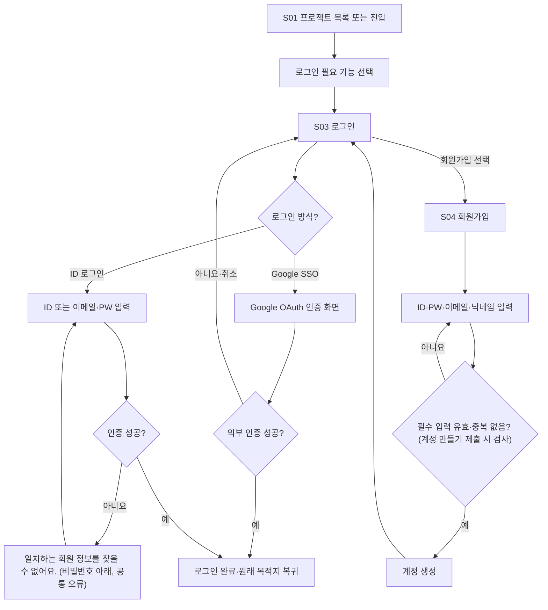
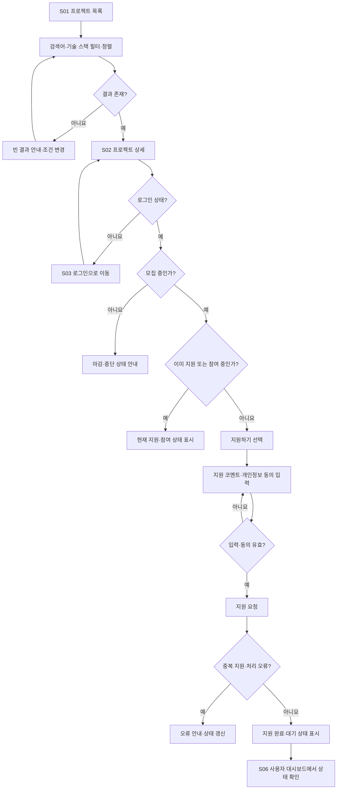
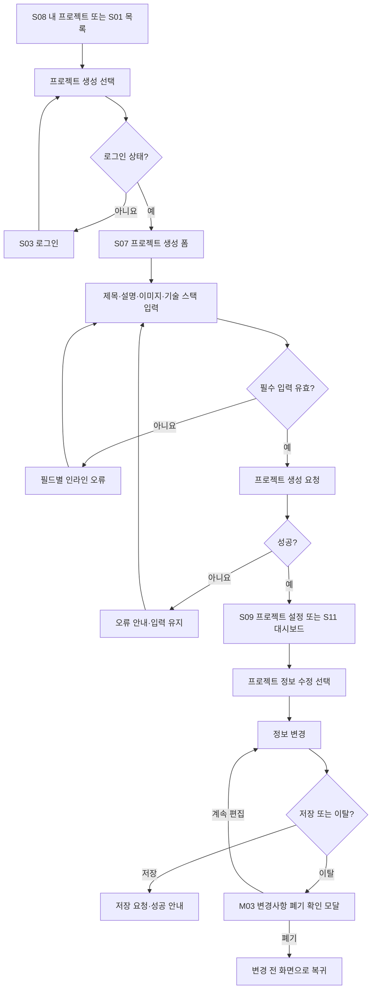
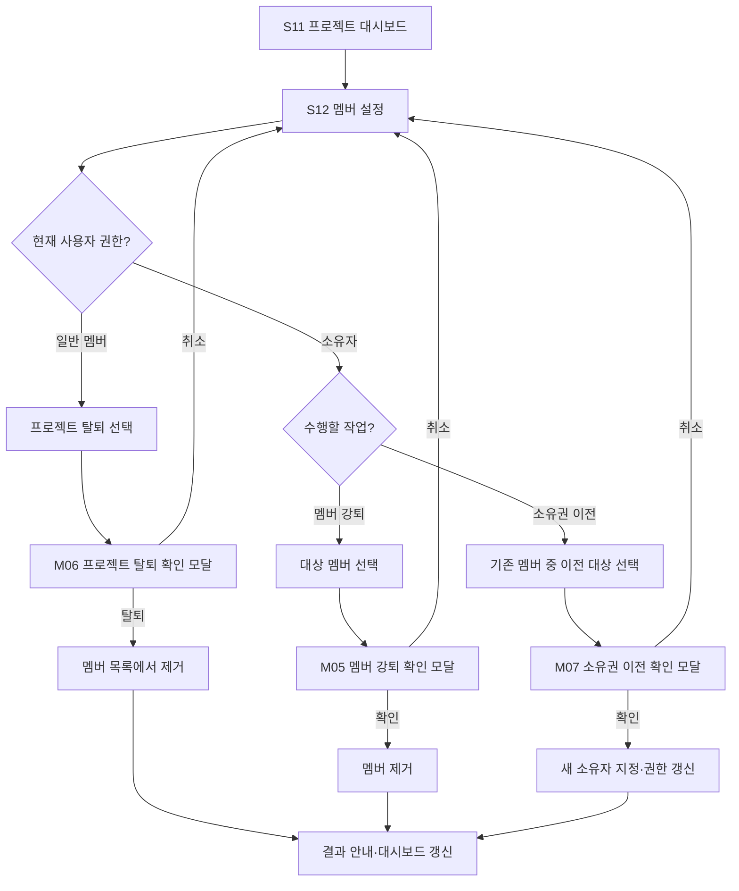
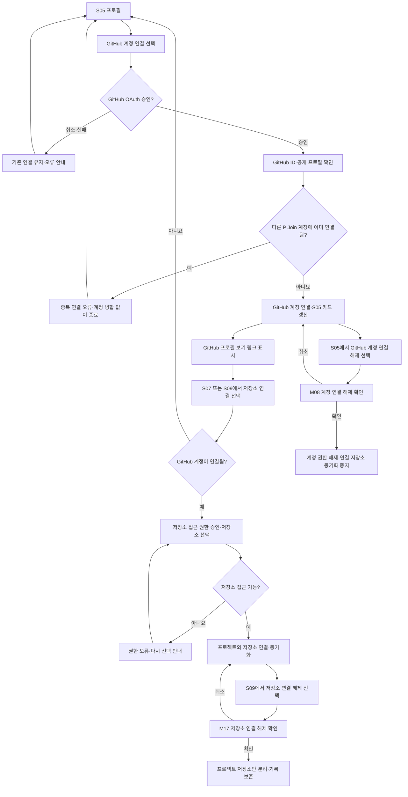
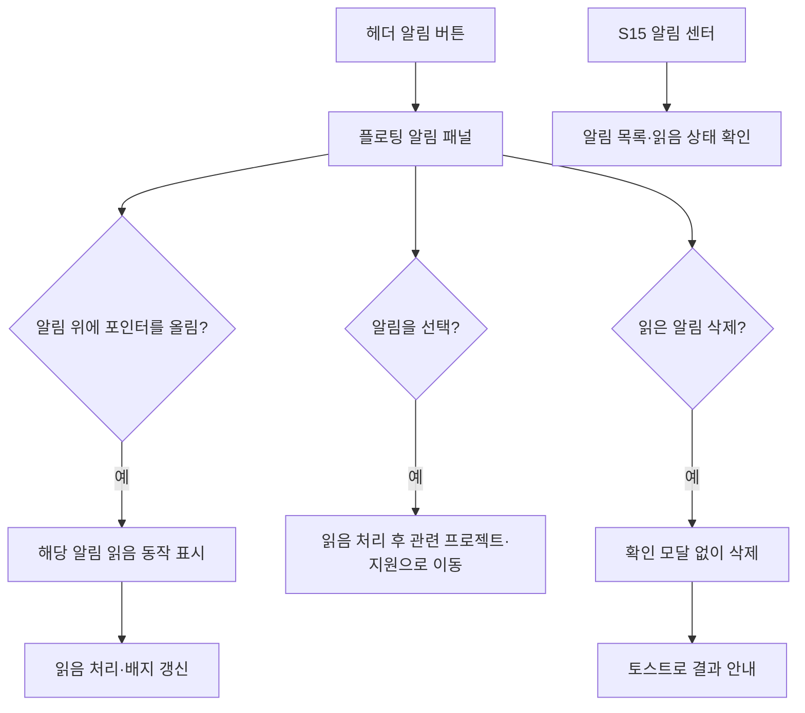
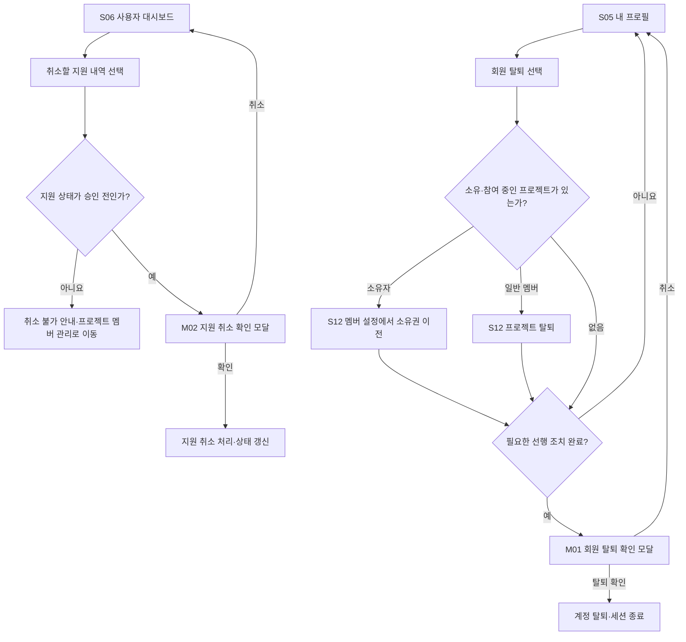
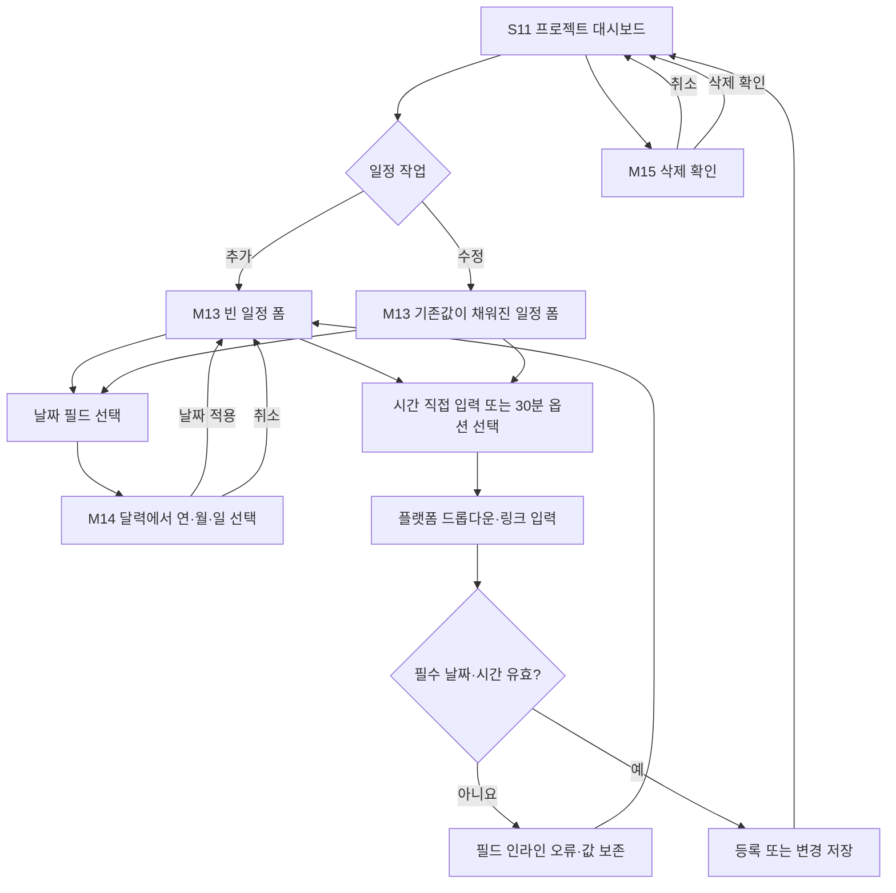

# P Join · 유저 플로우

화면과 모달 ID는 [정보 구조 및 화면 명세](02_ia.md)를 기준으로 합니다. 기능과 미확정 정책은 [제품 요구사항](01_prd.md)에서 확인합니다.

## [유저 플로우](https://www.figma.com/resource-library/user-flow/) · 핵심 흐름

### 표기 규칙

- 사각형: 페이지 또는 사용자 행동
- 마름모: 조건·권한·성공 여부 판단
- `Mxx · 모달` 노드: 실제 모달/오버레이가 열리는 지점
- 모달 취소는 호출 화면으로 돌아가며, 확인만 실제 변경 요청을 실행합니다.

### UF01 · 회원가입 및 로그인



### UF02 · 프로젝트 탐색 및 지원



### UF03 · 프로젝트 생성 및 정보 수정



### UF04 · 지원자 승인·거절 및 모집 기간 관리

1. S08에서 프로젝트를 선택하고 지원자 관리로 이동합니다.
2. S10에서 개별 지원자를 검토하고 승인하거나 M04를 거쳐 거절합니다. 처리 대상이 이미 바뀌었으면 최신 목록으로 갱신합니다.
3. 지원 결과를 사용자에게 알리고 지원 상태를 갱신합니다.
4. S09에서 모집 시작일·마감일을 정합니다. 접수 가능 여부와 화면의 모집 상태는 설정 기간·종료 상태와 일치해야 합니다.
5. 완료·중단 등 종료 상태의 변경 위치는 현재 시안에 조작부가 없으므로 별도 화면 결정이 필요합니다.

### UF05 · 프로젝트 멤버 관리 및 소유권 이전



### UF06 · GitHub 계정·저장소 연결·해제



### UF07 · GitHub 이슈 및 PR 협업

```mermaid
flowchart TD
    A["S11 프로젝트 대시보드"] --> B{"이슈 또는 PR?"}
    B -->|"이슈"| C["S13 이슈 목록·상세"]
    C --> D{"작업 선택?"}
    D -->|"생성·수정"| E["M10 이슈 입력"]
    D -->|"상태 변경"| H["상태 변경 확인"]
    E --> F{"입력 유효?"}
    F -->|"아니요"| E
    F -->|"예"| G["이슈 저장"]
    H --> G

    B -->|"PR"| I["S14 PR 목록·상세"]
    I --> J{"새 PR 작성 또는 리뷰 요청 확인?"}
    J -->|"작성자 A · 새 PR"| K["M11 PR 생성"]
    K --> L{"제목·기준·변경 브랜치·리뷰어 B 지정 완료?"}
    L -->|"아니요"| K
    L -->|"예"| M{"PR 생성 성공?"}
    M -->|"아니요"| N["오류 안내 · 입력 보존"]
    N --> K
    M -->|"예"| O["PR 생성 · B에게 리뷰 요청 알림"]
    O --> P["리뷰 요청 목록 또는 알림에서 PR 열기"]
    J -->|"리뷰어 B · 요청된 PR"| P
    P --> Q["S14 PR 상세 · 변경 내용과 대화 확인"]
    Q --> R{"현재 사용자가 작성자 A인가?"}
    R -->|"예"| S["자기 PR 리뷰 차단 · 진행 상태 표시"]
    R -->|"아니요"| T["M11 리뷰 등록"]
    T --> U{"리뷰 결과"}
    U -->|"변경 요청"| V["A에게 변경 요청 알림"]
    V --> W["A가 변경 후 같은 PR 갱신"]
    W --> X["B에게 재검토 알림"]
    X --> Q
    U -->|"승인"| Y{"저장소의 필수 리뷰 조건 충족?"}
    Y -->|"아니요"| Z["추가 리뷰 대기 · 병합 비활성"]
    Z --> Q
    Y -->|"예"| AA["병합 가능 상태"]
    AA --> AB["권한 있는 사용자가 M09에서 병합 확인"]
    AB -->|"취소"| Q
    AB -->|"확인"| AC["병합 결과 · S14 상태 갱신]
```

- A는 PR 생성 시 제목·기준 브랜치·변경 브랜치와 프로젝트 팀원 B를 리뷰어로 지정하고, 설명은 선택 입력합니다. 생성 성공 후 B에게 리뷰 요청 알림을 보냅니다.
- B는 리뷰 요청 목록이나 알림에서 PR을 열고 변경 내용을 확인한 뒤 `승인` 또는 `변경 요청`과 선택 코멘트를 제출합니다. PR 작성자는 해당 PR에 리뷰를 제출할 수 없습니다.
- 변경 요청이 있으면 A가 같은 PR을 갱신하고, 갱신 후 B에게 재검토 알림을 보냅니다. 저장소의 필수 승인 조건이 충족되고 미해결 변경 요청이 없을 때 병합을 허용합니다.
- 필수 승인자 수와 병합 보호 조건은 연결 저장소 설정을 따릅니다. 권한·연결·외부 서비스 오류가 나면 입력과 선택한 PR을 보존하고 복구 경로를 안내합니다.

### UF08 · 알림 확인 및 삭제



- 플로팅 패널에는 `전체 보기` 버튼을 두지 않습니다. S15 알림 센터는 기능 화면으로 유지하고 별도 진입 경로를 결정해야 합니다.

### UF09 · 지원 취소 및 회원 탈퇴



### UF10 · 위클리 일정 등록·수정·삭제



- 날짜는 M14에서 선택하고 시간은 24시간제 `HH:mm` 직접 입력 또는 30분 간격 옵션에서 고릅니다. 플랫폼 선택 UI는 S01 드롭다운 규칙을 재사용합니다.
- 잘못된 날짜·시간·URL은 저장을 막고 입력을 보존합니다. M15에서 취소하면 일정은 그대로 유지됩니다.

> **공통 예외:** 로그인·권한·외부 GitHub 연결 오류는 관련 화면에서 상황에 맞게 안내합니다. GitHub 계정 연결은 Google SSO·P Join 로그인 방식과 분리합니다. 모달 취소 시 호출 화면과 입력 맥락을 유지하며 변경은 확정하지 않습니다. 승인·거절·강퇴·소유권 이전·병합 결과는 사용자에게 알리고 관련 화면 상태에 반영합니다.
