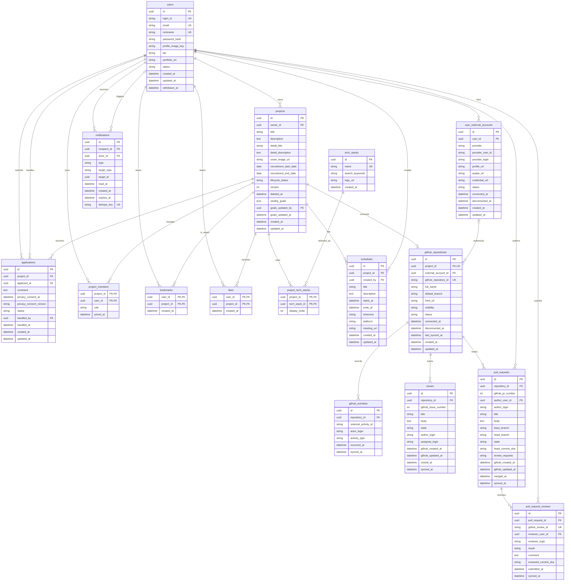

# P Join · 데이터베이스 ERD

P Join의 논리 데이터 모델은 아래 ERD의 핵심 테이블 16개를 기준으로 합니다. 기술 스택은 `project_tech_stacks` 연결 테이블에서 프로젝트와 카탈로그를 연결합니다. 기능을 구체화하는 데 필요한 필드는 첨부 ERD의 기본 구조를 유지하며 추가했습니다. 저장 필드는 snake_case를 사용하고 API 필드와의 차이는 [API 매핑 및 결정 항목](#api-mapping)에 정리합니다.

화면 ID는 [정보 구조 및 화면 명세](02_ia.md), API 계약은 [API 레퍼런스](08_api_reference.md#api-contract)와 [p-join-api ERD 검토](../p-join-api/index.html#erd)를 참고합니다.

## ERD

## 테이블 관계

| 영역 | 관계 | 규칙 |
| --- | --- | --- |
| 사용자·인증 | `users 1 — N user_external_accounts` | Google 가입·로그인 및 GitHub 연결. Google 기존 계정 연동은 제공하지 않음 |
| 프로젝트·팀 | `users 1 — N projects; users N — M projects via project_members` | 소유자는 반드시 같은 프로젝트의 멤버 |
| 프로젝트 기술 | `projects N — M tech_stacks via project_tech_stacks` | 기술 ID에 DB 외래 키를 적용하고 `display_order`로 표시 순서를 관리 |
| 지원 | `users 1 — N applications N — 1 projects` | 프로젝트·지원자당 현재 지원 한 행 |
| 반응 | `users N — M projects via likes / bookmarks` | 각각 사용자·프로젝트 복합 키 |
| 일정·목표 | `projects 1 — N schedules; projects.weekly_goals` | 목표는 현재 주만 프로젝트에 저장 |
| GitHub | `projects 1 — 0..1 github_repositories; repositories 1 — N github_activities / issues / pull_requests` | 프로젝트당 저장소 연결 레코드 하나. GitHub가 동기화 데이터의 정본 |
| PR 리뷰 | `pull_requests 1 — N pull_request_reviews` | 현재 요청 대상은 pull_requests.review_requests에 저장 |
| 알림 | `users 1 — N notifications` | 사용자별 읽음 및 만료 |

S11 최근 활동은 GitHub 활동·현재 지원 상태·현재 일정과 최근 목표 수정 정보를 합쳐 조회합니다. 각 항목은 원본 종류와 ID를 조합해 식별합니다. 삭제되거나 덮어쓴 과거 활동은 표시할 수 없으며 별도 전체 이력은 저장하지 않습니다.

## 테이블 정의

PK는 기본 키, FK는 외래 키, UNIQUE는 유일 제약을 뜻합니다.

### `users` · 사용자와 공개 프로필

관련 화면 S03–S05, S10–S12

| 필드 | 타입·제약 | 설명 |
| --- | --- | --- |
| `id` | UUID PK | 사용자 식별자 |
| `login_id` | string NULL, UNIQUE | 로컬 로그인 ID; Google 전용 계정은 비어 있을 수 있음 |
| `email` | string NULL, UNIQUE | 정규화한 이메일; 외부 제공자의 이메일 제공 여부에 따라 NULL 가능 |
| `password_hash` | string NULL | 로컬 인증이 있을 때만 저장; 평문 금지 |
| `nickname` | string NOT NULL, UNIQUE | 표시 이름; 중복 검사는 서버가 최종 판정 |
| `bio` | text NULL | 소개글 |
| `portfolio_url` | string NULL | 외부 포트폴리오 URL |
| `profile_image_key` | string NULL | 업로드 객체 식별자; 공개 URL은 응답에서 생성 |
| `status` | enum NOT NULL | active \| withdrawn |
| `created_at / updated_at` | timestamp NOT NULL | 생성 및 수정 시각 |
| `withdrawn_at` | timestamp NULL | 탈퇴 시각 |

### `user_external_accounts` · Google 가입·로그인 식별자 및 GitHub 연결

관련 화면 S03, S05, S07, S09

| 필드 | 타입·제약 | 설명 |
| --- | --- | --- |
| `id` | UUID PK | 외부 계정 연결 식별자 |
| `user_id` | UUID FK → users.id | 계정 소유자 |
| `provider` | enum NOT NULL | google \| github; Google은 가입·로그인 전용으로 해제 불가, GitHub는 계정 연결 전용 |
| `provider_user_id` | string NOT NULL | 제공자의 불변 사용자 ID |
| `provider_login / profile_url` | string NULL | GitHub 공개 ID와 프로필 링크 |
| `avatar_url` | string NULL | GitHub 프로필 이미지 주소 |
| `credential_ref` | string NULL | 암호화된 별도 자격 증명 저장소의 참조; 토큰 원문 금지 |
| `status` | enum NOT NULL | connected \| expired \| disconnected |
| `connected_at / disconnected_at` | timestamp NULL | 연결 및 해제 시각 |
| `created_at / updated_at` | timestamp NOT NULL | 생성 및 수정 시각 |

### `tech_stacks` · 검색 가능한 기술 카탈로그

관련 화면 S01, S05, S07, S09

| 필드 | 타입·제약 | 설명 |
| --- | --- | --- |
| `id` | UUID PK | 기술 식별자 |
| `name` | string NOT NULL, UNIQUE | 표준 표시명 |
| `search_keywords` | text NULL | 검색 별칭 |
| `logo_url` | string NULL | 공식 로고 주소 |
| `created_at` | timestamp NOT NULL | 생성 시각 |

### `project_tech_stacks` · 프로젝트와 기술 스택 연결

관련 화면 S01, S07–S09

| 필드 | 타입·제약 | 설명 |
| --- | --- | --- |
| `project_id` | UUID PK, FK → projects.id | 기술을 사용하는 프로젝트 |
| `tech_stack_id` | UUID PK, FK → tech_stacks.id | 프로젝트에서 선택한 기술 |
| `display_order` | int NOT NULL, DEFAULT 0 | 프로젝트 화면에 표시할 순서 |

프로젝트와 기술 스택은 다대다 관계입니다. 복합 기본 키로 같은 기술의 중복 연결을 막고, 기술 검색은 연결 테이블을 기준으로 처리합니다.

### `projects` · 프로젝트 기본 정보와 모집 기간

관련 화면 S01, S02, S07–S09

| 필드 | 타입·제약 | 설명 |
| --- | --- | --- |
| `id` | UUID PK | 프로젝트 식별자 |
| `owner_id` | UUID FK → users.id, NOT NULL | 현재 소유자; 프로젝트 멤버여야 함 |
| `title` | string NOT NULL | 프로젝트 제목 |
| `description` | text NOT NULL | 상세 설명; 목록 요약은 이 값에서 파생 |
| `detail_title / detail_description` | string NULL / text NULL | 프로젝트 상세 페이지의 세부 제목과 설명 |
| `cover_image_url` | string NULL | 프로젝트 대표 이미지 주소 |
| `recruitment_start_date / recruitment_end_date` | date NULL | 둘 다 NULL 또는 둘 다 설정; 시작일 ≤ 마감일 |
| `lifecycle_status` | enum NOT NULL | active \| completed \| stopped; 완료·중단 프로젝트는 지원 불가 |
| `created_at / updated_at` | timestamp NOT NULL | 생성 및 수정 시각 |
| `version` **제안** | int | 낙관적 잠금을 도입하면 수정·상태 전이에 사용 |
| `deleted_at` **제안** | timestamp NULL | 논리 삭제 시각 및 조회 제외 기준 |
| `weekly_goals` | JSON object NULL | 현재 주 목표: {weekStartDate, items:[string]}; 이전 주 목표는 저장하지 않음. |
| `goals_updated_by / goals_updated_at` | UUID NULL / timestamp NULL | 최근 목표 수정자와 수정 시각; 활동 표시용. |

### `applications` · 프로젝트별 지원 현황

관련 화면 S02, S06, S08, S10

| 필드 | 타입·제약 | 설명 |
| --- | --- | --- |
| `id` | UUID PK | 지원 식별자 |
| `project_id` | UUID FK → projects.id | 대상 프로젝트 |
| `applicant_id` | UUID FK → users.id | 지원자 |
| `comment` | text NOT NULL | 공백만 입력 불가 |
| `privacy_consent_at` | timestamp NOT NULL | 동의 시각; 동의 내용 버전은 별도 필드 |
| `privacy_consent_version` | string NOT NULL | 당시 동의 문서 버전 |
| `status` | enum NOT NULL | pending \| approved \| rejected \| cancelled |
| `handled_by` | UUID NULL, FK → users.id | 승인·거절 처리자 |
| `handled_at` | timestamp NULL | 승인·거절 처리 시각 |
| `created_at / updated_at` | timestamp NOT NULL | 최초 지원·현재 상태 수정 시각 |

### `project_members` · 현재 프로젝트 멤버

관련 화면 S06, S10–S12

| 필드 | 타입·제약 | 설명 |
| --- | --- | --- |
| `project_id` | UUID PK, FK → projects.id | 프로젝트 |
| `user_id` | UUID PK, FK → users.id | 참여 사용자 |
| `joined_at` | timestamp NOT NULL | 가입 또는 승인 시각 |
| `role` **제안** | enum | API의 `OWNER`·`MEMBER`. 저장하거나 `projects.owner_id`에서 계산할지 결정 필요 |

### `likes` / `bookmarks` · 좋아요와 북마크

관련 화면 S01, S02, S06

| 필드 | 타입·제약 | 설명 |
| --- | --- | --- |
| `user_id` | UUID PK, FK → users.id | 사용자 |
| `project_id` | UUID PK, FK → projects.id | 대상 프로젝트 |
| `created_at` | timestamp NOT NULL | 반응 생성 시각 |

### `schedules` · 위클리 일정

관련 화면 S11

| 필드 | 타입·제약 | 설명 |
| --- | --- | --- |
| `id` | UUID PK | 일정 식별자 |
| `project_id` | UUID FK → projects.id | 프로젝트 |
| `created_by` | UUID FK → users.id | 일정을 등록한 사용자 |
| `starts_at` | timestamp NOT NULL | 오프셋 포함 시각을 UTC로 정규화 |
| `timezone` | string NOT NULL | 표시에 사용할 IANA 시간대 |
| `platform` | string NULL | 플랫폼; 선택 사항 |
| `meeting_url` | string NULL | 회의 링크; 입력 시 URL 검증 |
| `title` | string NULL | S11 일정 제목 |
| `description` | text NULL | 일정 설명 |
| `ends_at` | timestamp NULL | 일정 종료 시각; 시작 시각 이후인지 검증 |
| `version` **제안** | int | S11 수정·삭제 시 버전 충돌 검사 |
| `created_at / updated_at` | timestamp NOT NULL | 생성 및 수정 시각 |

### `notifications` · 사용자별 알림

관련 화면 S01, S15

| 필드 | 타입·제약 | 설명 |
| --- | --- | --- |
| `id` | UUID PK | 알림 식별자 |
| `recipient_id` | UUID FK → users.id | 수신자 |
| `actor_id` | UUID NULL, FK → users.id | 행위자; 시스템 알림은 NULL |
| `type` | string NOT NULL | 알림 유형 |
| `target_type / target_id` | string / UUID NULL | 앱 내부 이동 대상; 허용 목록으로 검증 |
| `read_at` | timestamp NULL | NULL은 읽지 않음 |
| `created_at / expires_at` | timestamp NOT NULL | 생성 및 만료 시각; 보관 30일 |
| `dedupe_key` | string NULL, UNIQUE | 이벤트 중복 생성 방지 |

### `github_repositories` · 프로젝트의 GitHub 저장소 연결

관련 화면 S07, S09, S11–S14

| 필드 | 타입·제약 | 설명 |
| --- | --- | --- |
| `id` | UUID PK | 연결 식별자 |
| `project_id` | UUID FK → projects.id, UNIQUE | 프로젝트당 저장소 연결 레코드 하나 |
| `external_account_id` | UUID NULL, FK → user_external_accounts.id | 권한을 승인한 GitHub 계정 |
| `github_repository_id` | string NOT NULL, UNIQUE | GitHub의 불변 저장소 ID |
| `full_name / default_branch` | string NOT NULL / NULL | 표시용 owner/repo와 기본 브랜치 |
| `html_url` | string NULL | GitHub 저장소 페이지 URL |
| `visibility` | enum NULL | private \| public \| internal |
| `created_at / updated_at` | timestamp NOT NULL | 로컬 연결 레코드의 생성·수정 시각 |
| `status` | enum NOT NULL | connected \| expired \| disconnected \| error |
| `connected_at / disconnected_at / last_synced_at` | timestamp NULL | 연결·해제·최근 동기화 시각 |

ETag와 웹훅 전달 중복 기록은 동기화 메타데이터에, 설치 토큰은 비밀 저장소에 보관하는 제안입니다.

### `github_activities` · GitHub 동기화 활동

관련 화면 S09, S11

| 필드 | 타입·제약 | 설명 |
| --- | --- | --- |
| `id` | UUID PK | 내부 식별자 |
| `repository_id` | UUID FK → github_repositories.id | 연결 이력 |
| `external_activity_id` | string NOT NULL | GitHub 측 식별자; 저장소 범위에서 유일 |
| `actor_login` | string NULL | 외부 작성자 |
| `activity_type` | string NOT NULL | 커밋 등 활동 유형 |
| `occurred_at / synced_at` | timestamp NOT NULL | 발생·동기화 시각 |

### `issues` · GitHub 이슈의 읽기 모델

관련 화면 S13

| 필드 | 타입·제약 | 설명 |
| --- | --- | --- |
| `id` | UUID PK | 내부 식별자 |
| `repository_id` | UUID FK → github_repositories.id | 연결 이력 |
| `github_issue_number` | int NOT NULL | 저장소 내 번호 |
| `title / body` | string NOT NULL / text NULL | 제목 및 본문 |
| `state` | enum NOT NULL | open \| closed |
| `author_login / assignee_login` | string NULL | 외부 GitHub 사용자 |
| `github_created_at / github_updated_at / closed_at` | timestamp NULL | 외부 시각 |
| `synced_at` | timestamp NOT NULL | 마지막 동기화 시각 |

### `pull_requests` · GitHub PR의 읽기 모델

관련 화면 S11, S14

| 필드 | 타입·제약 | 설명 |
| --- | --- | --- |
| `id` | UUID PK | 내부 식별자 |
| `repository_id` | UUID FK → github_repositories.id | 연결 이력 |
| `github_pr_number` | int NOT NULL | 저장소 내 번호 |
| `author_user_id` | UUID FK → users.id | 앱 작성자 |
| `author_login` | string NOT NULL | GitHub 작성자의 로그인 스냅샷 |
| `title / body` | string NOT NULL / text NULL | 제목 및 설명 |
| `base_branch / head_branch` | string NOT NULL | 기준 및 변경 브랜치 |
| `state` | enum NOT NULL | open \| closed \| merged |
| `head_commit_sha` | string NOT NULL | 현재 head 커밋 |
| `github_created_at / github_updated_at / merged_at` | timestamp NULL | 외부 시각 |
| `synced_at` | timestamp NOT NULL | 마지막 동기화 시각 |
| `review_requests` | JSON array NOT NULL, DEFAULT [] | 현재 요청된 GitHub 리뷰어 로그인 목록; GitHub 동기화 시 교체. 제출된 리뷰는 pull_request_reviews에 저장. |

### `pull_request_reviews` · PR 리뷰와 검토 커밋 이력

관련 화면 S14

| 필드 | 타입·제약 | 설명 |
| --- | --- | --- |
| `id` | UUID PK | 내부 식별자 |
| `pull_request_id` | UUID FK → pull_requests.id | 대상 PR |
| `github_review_id` | string NULL, UNIQUE | GitHub 리뷰 ID. 동기화와 웹훅 재처리 시 원격 ID로 upsert |
| `reviewer_user_id` | UUID FK → users.id | 리뷰를 제출한 앱 사용자 |
| `reviewer_login` | string NOT NULL | GitHub 리뷰어 로그인 스냅샷 |
| `result` | enum NOT NULL | approved \| changes_requested |
| `comment` | text NULL | 리뷰 코멘트 |
| `reviewed_commit_sha` | string NOT NULL | 검토한 head 커밋 |
| `submitted_at / synced_at` | timestamp NOT NULL | 제출·동기화 시각 |

## 유일 제약과 인덱스

| 대상 | 제약·인덱스 제안 | 목적 |
| --- | --- | --- |
| users | login_id·email·nickname 각각 유일; NULL 자격 허용 | Google 가입자는 ID·비밀번호 없이 가입 |
| user_external_accounts | (provider, provider_user_id) 유일; 활성 (user_id, provider) 유일; 동일 계정 재연결 시 기존 행 갱신 | Google 식별자 및 GitHub 연결 중복 방지 |
| applications | (project_id, applicant_id) 유일; (project_id, status, created_at) 인덱스 | 중복 지원 방지와 목록 조회 |
| project_members · 연결·반응 | project_members, likes, bookmarks는 각 두 FK의 복합 PK | 중복 방지 |
| github_repositories | `project_id` 및 `github_repository_id` 각각 유일 | 프로젝트당 저장소 연결 하나, 동일 원격 저장소 중복 연결 방지 |
| issues · pull_requests | `(repository_id, github_issue_number)`와 `(repository_id, github_pr_number)` 각각 유일 | 저장소 내 번호로 조회·동기화 |
| pull_requests | 상태·원격 갱신 시각 인덱스 | 상태 필터와 최신순 조회 |
| github_activities · pull_request_reviews | 활동은 저장소 범위에서 원격 ID 유일; 리뷰 원격 ID 유일 | 재동기화 시 중복 방지 |
| notifications · schedules | notifications(recipient_id, read_at, created_at), schedules(project_id, starts_at) | 알림 및 일정 조회 |

`project_tech_stacks`는 기술 선택을 행 단위로 저장하므로 외래 키와 복합 기본 키가 참조 무결성 및 중복 방지를 담당합니다. 프로젝트별 기술 다중 검색은 연결 테이블에서 선택한 모든 기술 ID와 일치하는 프로젝트를 찾습니다.

## API 매핑 및 결정 항목

| 영역 | API 계약과 저장 모델 |
| --- | --- |
| 사용자 | `avatarUrl`은 `profile_image_key`로 만든 공개 URL에 대응합니다. `websiteUrl`과 기존 `portfolio_url`을 같은 필드로 다룰지 결정해야 합니다. |
| 지원 | API의 `ACCEPTED`는 기존 ERD의 `approved`에 해당합니다. 승인 시 지원 상태 갱신과 멤버 등록은 같은 트랜잭션에서 처리하는 안입니다. 재지원과 대량 거절의 조건은 검토 중입니다. |
| 멤버 | `OWNER`·`MEMBER` 권한과 소유권 이전을 정할 때 `projects.owner_id`가 같은 프로젝트의 멤버를 가리키도록 유지합니다. |
| 프로젝트 | `version`과 `deleted_at`은 추가 제안입니다. 모집 기간으로 계산하는 상태와 생명주기 전이의 관계를 확정해야 합니다. |
| 일정 | `scheduledAt`은 `starts_at`, `link`는 `meeting_url`에 대응합니다. API의 오프라인 링크 규칙, 플랫폼 값, 버전 검사와 물리 삭제 정책을 맞춰야 합니다. |
| 알림 | API는 `message`와 `targetUrl`을 반환합니다. 메시지 생성 방식과 `target_type`·`target_id`를 내부 URL로 변환하는 규칙을 확정해야 합니다. 기존의 30일 만료와 읽은 알림의 개별 삭제 정책을 적용하는 안입니다. |
| 이슈 | 이 문서의 `issues.state`는 API의 `state`와 대응합니다. 카탈로그에서 참조하는 별도 ERD의 `status` 명칭과 통일이 필요합니다. |
| PR 리뷰 | API 읽기 모델은 `PENDING`, `COMMENTED`, `DISMISSED`도 반환하고 검토 SHA·제출 시각에 NULL을 허용합니다. 현재 승인·변경 요청 중심 저장 모델을 확장할 범위를 결정해야 합니다. |
| GitHub 연결 | 프로젝트당 저장소 연결은 한 건으로 제한합니다. 연결 해제 뒤 저장소·PR·리뷰 데이터 보존 기간과 재연결 시 기존 레코드를 갱신할지 결정해야 합니다. |
